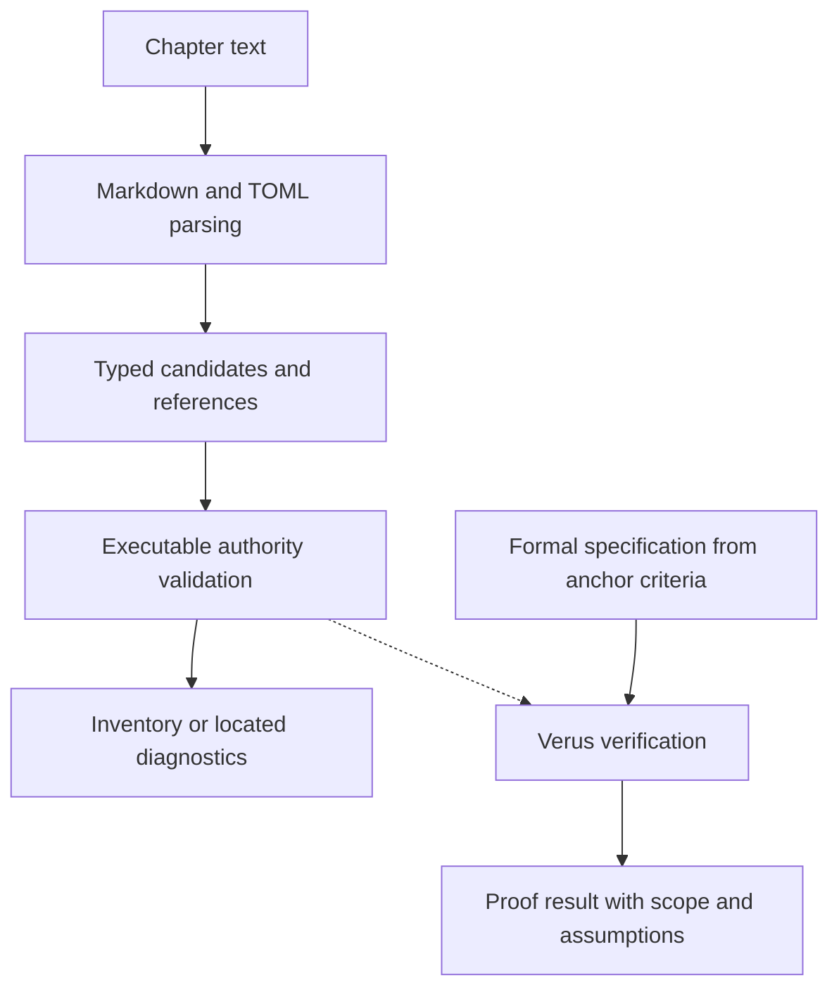

# Formal Verification

**Status: local proof of concept implemented; engineer review pending.** Verus verifies selected executable engine logic,
starting with [valid authority](rust-engine.md#engine-valid-authority). Its
authority remains [traceable properties](../authority/requirements.md#requirement-traceable-properties).
The anchor and its verification criteria live in Rust Engine; this chapter defines
the proof boundary and integration. A GitHub proof job is implemented locally;
its remote execution remains to be demonstrated.

This experiment also develops a reusable way for projects to connect anchor
criteria to proofs of their production code. The engine is the first case. The
[criterion schema](anchor-definitions.md#verification-methods) declares required
evidence methods; Verus is this project's chosen proof tool. Formal specifications
and supporting proofs live with the code and identify the anchor and criterion
they address. Refine the association convention through the first proof before
defining a general source-annotation syntax or evidence adapter.

## First proof: authority validation

The first specification expresses the existing [authority rules](authority-definitions.md#validating-authority-relationships):
an anchor has at least one authority; every reference resolves to exactly one valid
record of the declared kind; references are distinct; and accepted records cite
only accepted authorities. Include the requirements cited by decisions, including
unreferenced decisions. Draft records may cite draft or accepted authority.

Prove that the executable validator succeeds exactly when these conditions hold
over its declared input domain. Proving rejection as well as acceptance avoids a
validator that satisfies a one-way safety statement by rejecting every input.
The domain must include empty lists, duplicate identities, missing or invalid
targets, wrong kinds, repeated references, and incompatible statuses. Preconditions
must not assume away these cases or assume the property being proved.

The first proof of concept is local and limited to this authority validator. Its
claim is `validator accepts ⇔ authority rules hold` for the complete typed input.
This does not imply that parsing succeeded or that the whole Book is valid;
existing parse errors must still prevent a successful inventory.

Use a small input matrix to review the specification and integration tests:

| Input | Authority result |
| --- | --- |
| Draft anchor with a nonempty list of distinct, valid requirement or decision targets | Accept; targets may be draft or accepted. |
| Accepted anchor with a nonempty list of distinct, valid, accepted authorities | Accept. |
| Anchor with no authorities | Reject, including in Prototyping. |
| Missing, invalid, ambiguous, wrong-kind, or repeated authority target | Reject. |
| Accepted anchor or decision citing a draft authority | Reject. |
| Decision with no requirements | Accept; requirements are optional for decisions. |
| Decision citing requirements, even if no anchor cites the decision | Check every reference under the same resolution and status rules. |

These cases guide human review and tests; the proof must quantify over the input
collections rather than establish only these examples. Parser correctness,
diagnostic wording and locations, remote verification, and a general proof-evidence
framework are outside this first task.

## Prove the production implementation

`src/records/authority.rs` contains the executable checks, their contracts, and
proof annotations. `schema.rs` calls its verified presence check when decoding
anchor authorities; `inventory.rs` passes the complete candidate collection to
its verified `validate_authorities` function. `read_records` retains existing errors and prevents
inventory construction whenever diagnostics exist. Ordinary builds execute these
same function bodies; there is no proof-only implementation or alternate validator.

The module owns lookup, iteration, and authority acceptance. Its internal
candidate contains an optional identity, kind, acceptance status, references,
and a `decoded` flag indicating whether decoding produced a record. That flag is
not an authority-validation result or a precondition that relationships are valid.
Invalid candidates retain recoverable identities and participate in target lookup;
their existing decoding errors still prevent a successful inventory.

The specification names `engine-valid-authority` and `formal-authority` in the
module. `reference_satisfies_authority_rules` combines three named predicates:
`reference_is_not_repeated` checks duplicates within one record,
`resolves_uniquely_to` checks identity and uniqueness across all candidates,
and `target_is_suitable_authority` checks decoding, kind, and acceptance status.
Undecodable candidates still count toward identity ambiguity.
`record_satisfies_authority_rules` adds required authority;
`records_satisfy_authority_rules` quantifies over the collection. `validate_authorities` ensures its violation list
is empty if and only if those rules hold. Loop invariants connect each processed
prefix to that complete specification. Supporting lemmas can move to separate
modules when useful; file layout does not determine the proof boundary.

This prototype uses string identities directly, borrowed slices, linear target
lookup, and a scan of earlier references for duplicates. The simplicity makes the
proof inspectable, at the cost of repeated scans. It has not been optimized or
benchmarked for large inventories. Global duplicate-identity diagnostics,
candidate conversion, backlinks, and diagnostic locations remain outside the
proof and are covered by integration tests.

The solid runtime path uses the same function bodies that Verus verifies. The
verification path runs separately; reading or rendering a Book never invokes it.
The proof must not rely on a rendered or valid repository Book.

## What the proof establishes

| Boundary | Initial treatment |
| --- | --- |
| Authority lookup and validation | Verify the executable functions against the formal conditions, including collection traversal and all authority edges. |
| Markdown/TOML decoding and candidate conversion | Review and test that identity, kind, status, references, invalid candidates, and existing errors are faithfully represented. Parser correctness is outside the first proof. |
| Inventory construction and diagnostics | Review the call path and test that validation failures cannot become success; preserve located diagnostics and the all-or-nothing inventory. Diagnostic wording and locations are not initially proved. |
| Public library and mdBook adapter | Exercise independent valid and invalid fixtures through the real APIs/process. No successful partial inventory or Book JSON on invalid authority. |

A mathematical model may describe the specification, but proving that model alone
does not prove the engine. Identify every unverified conversion, external function
contract, and trusted assumption. Do not assume a validation function's result or
mark its body trusted to obtain a successful proof. Review preconditions for
consistency and demonstrate valid inputs satisfying them. The verifier, solver,
and Rust compilation remain part of the trusted toolchain.

Human review establishes whether the formal statement matches the anchor. A proof
does not establish that an authority logically justifies a property or that a
human approved an acceptance status. The first result is a proof of authority
logic under stated assumptions, supported by integration tests—not a proof of
the entire parser, renderer, or engine.

## Cargo and continuous integration

[Verus](https://verus-lang.github.io/verus/guide/) supplies specifications and
proofs for executable Rust, with limits on supported language features and libraries.
Its [Cargo integration](https://verus-lang.github.io/verus/guide/cargo_verus.html)
supports verification through `cargo verus verify` and ordinary Cargo builds of
annotated code. The pinned setup and native verification command are documented
in CONTRIBUTING.

Pin a compatible Verus release, its required Rust toolchain, and `vstd` during the
prototype. Check the engine's Rust 1.85 minimum and stable builds before adopting
the dependency. Start within the current package; split out a crate only if the
experiment establishes a dependency/toolchain need, keeping that crate on the
production call path. Resolve any minimum-version change explicitly.

Treat compatibility as the first implementation checkpoint: confirm that a small
representative validator using the required types and collection operations both
verifies and builds normally before undertaking the full extraction. If that
requires a different package boundary or minimum Rust version, bring that concrete
constraint back for design review before expanding the refactor.

Run full verification for the selected proof scope locally and in a separate
GitHub job, alongside ordinary tests and mutation testing. Check that the intended
functions were verified: an empty or skipped verification run is not success.
The GitHub job uses a fresh build directory and checks the verifier's JSON report
for full-crate verification, successful results for the seven production authority
functions, and zero errors. It also runs independent engine and integration tests
on the same checkout. Selected results and revision metadata are retained on
success and failure; no generated Book is needed. CONTRIBUTING documents the job
and its limits. Passing and deliberate-failure remote runs remain pending.

Demonstrate that a deliberate behavioral defect fails verification, then restore
the implementation and rerun. Retain failure evidence; a timeout or tool failure
is inconclusive. Do not weaken specifications or add assumptions to hide defects.

cargo-mutants 27.1.0 discovers no mutations inside this module's `verus!` block.
Integration code is mutation-tested separately; a deliberate status-check defect
was rejected by the proof. This is a recorded coverage gap, not full mutation
coverage of annotated code. Tests remain required, and mutation findings stay in
their [own roadmap](../implementation-roadmaps/mutation-testing.md).

## Evidence and later integration

Record the anchor and criterion IDs, specification and executable function names,
code and Book revisions, verifier/toolchain versions, command and selected scope,
result, assumptions, unverified boundaries, and supporting run. Tie integration
test results to the same implementation revision. Reassess affected proofs when
code, specifications, conversion, or dependencies change; earlier success does not
prove the new revision.

Initially, maintain this evidence in the [Formal Verification roadmap](../implementation-roadmaps/formal-verification.md).
Keep generated proof output out of authored Book sources and review artifacts
for public-safe content. Required verification methods do not create an automatic
verified badge; proof results remain separate from the authored anchor.
Later evidence ingestion can associate Verus results with anchors alongside tests
and other verifiers. That adapter and its schema remain deferred; proof development
does not depend on building them first.
