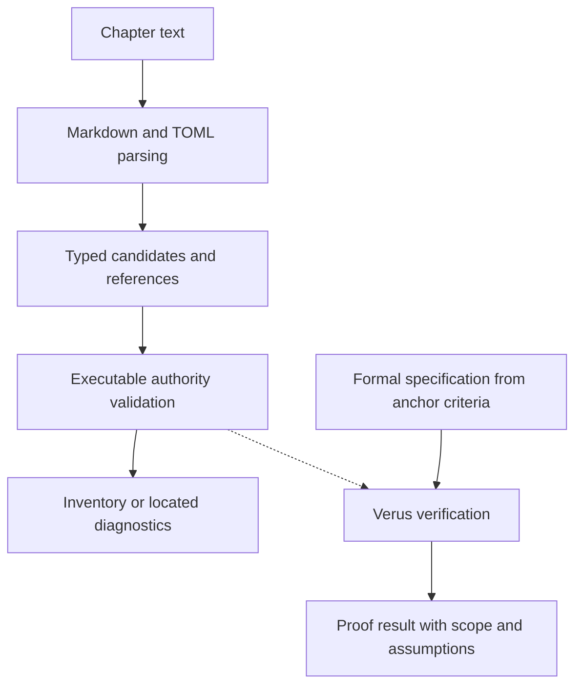

# Formal Verification

**Status: planned prototype.** Verus will verify selected executable engine logic,
starting with [valid authority](rust-engine.md#engine-valid-authority). Its
authority remains [traceable properties](../authority/requirements.md#requirement-traceable-properties).
The anchor and its verification criteria live in Rust Engine; this chapter defines
the proof boundary and integration. No proof or verifier workflow is implemented.

This experiment also develops a reusable way for projects to connect anchor
criteria to proofs of their production code. The engine is the first case. The
[criterion schema](anchor-definitions.md#verification-methods) declares required
evidence methods; Verus is this project's chosen proof tool. Formal specifications
and supporting proofs live with the code and identify the anchor and criterion
they address. Refine the association convention through the first proof before
defining a general source-annotation syntax or evidence adapter.

## First proof: authority validation

The first specification expresses the existing [authority rules](authority-definitions.md#validating-authority-relationships):
an anchor has at least one authority; every reference resolves to exactly one valid
record of the declared kind; references are distinct; and accepted records cite
only accepted authorities. Include the requirements cited by decisions, including
unreferenced decisions. Draft records may cite draft or accepted authority.

Prove that the executable validator succeeds exactly when these conditions hold
over its declared input domain. Proving rejection as well as acceptance avoids a
validator that satisfies a one-way safety statement by rejecting every input.
The domain must include empty lists, duplicate identities, missing or invalid
targets, wrong kinds, repeated references, and incompatible statuses. Preconditions
must not assume away these cases or assume the property being proved.

## Prove the production implementation

Today, `src/records/schema.rs` checks required authority fields and
`src/records/inventory.rs` resolves references and prevents construction of an
inventory when diagnostics exist. Refactor the relevant logic into a focused
internal authority-validation module under `records`. `read_records` must call
its verified executable functions in normal builds. Keep one implementation;
do not create a proof-only copy or an unverified alternative behind a build flag.

The module should own lookup, iteration, and the authority acceptance conditions,
not just accept a caller's precomputed “valid authority” boolean. It operates on
explicit typed record candidates and references, including invalid candidates and
their recoverable identities. Preserve ambiguity and invalid-input information
when converting parser output. Exact types and signatures will be settled in the
prototype, without making proof-specific details part of the public API.

The solid runtime path uses the same function bodies that Verus verifies. The
verification path runs separately; reading or rendering a Book never invokes it.
The proof must not rely on a rendered or valid repository Book.

## What the proof establishes

| Boundary | Initial treatment |
| --- | --- |
| Authority lookup and validation | Verify the executable functions against the formal conditions, including collection traversal and all authority edges. |
| Markdown/TOML decoding and candidate conversion | Review and test that identity, kind, status, references, invalid candidates, and existing errors are faithfully represented. Parser correctness is outside the first proof. |
| Inventory construction and diagnostics | Review the call path and test that validation failures cannot become success; preserve located diagnostics and the all-or-nothing inventory. Diagnostic wording and locations are not initially proved. |
| Public library and mdBook adapter | Exercise independent valid and invalid fixtures through the real APIs/process. No successful partial inventory or Book JSON on invalid authority. |

A mathematical model may describe the specification, but proving that model alone
does not prove the engine. Identify every unverified conversion, external function
contract, and trusted assumption. Do not assume a validation function's result or
mark its body trusted to obtain a successful proof. Review preconditions for
consistency and demonstrate valid inputs satisfying them. The verifier, solver,
and Rust compilation remain part of the trusted toolchain.

Human review establishes whether the formal statement matches the anchor. A proof
does not establish that an authority logically justifies a property or that a
human approved an acceptance status. The first result is a proof of authority
logic under stated assumptions, supported by integration tests—not a proof of
the entire parser, renderer, or engine.

## Cargo and continuous integration

[Verus](https://verus-lang.github.io/verus/guide/) supplies specifications and
proofs for executable Rust, with limits on supported language features and libraries.
Its [Cargo integration](https://verus-lang.github.io/verus/guide/cargo_verus.html)
supports verification through `cargo verus verify` and ordinary Cargo builds of
annotated code. These are tool capabilities, not configured project commands yet.

Pin a compatible Verus release, its required Rust toolchain, and `vstd` during the
prototype. Check the engine's Rust 1.85 minimum and stable builds before adopting
the dependency. Start within the current package; split out a crate only if the
experiment establishes a dependency/toolchain need, keeping that crate on the
production call path. Resolve any minimum-version change explicitly.

Run full verification for the selected proof scope locally and in a separate
GitHub job, alongside ordinary tests and mutation testing. Check that the intended
functions were verified: an empty or skipped verification run is not success.
Demonstrate that a deliberate behavioral defect fails verification, then restore
the implementation and rerun. Retain failure evidence; a timeout or tool failure
is inconclusive. Do not weaken specifications or add assumptions to hide defects.

The prototype must assess whether cargo-mutants reaches the new annotated code.
Record any unsupported coverage; Verus success does not silently discharge mutation
findings or justify removing tests. Existing mutation survivors remain tracked in
their [own roadmap](../implementation-roadmaps/mutation-testing.md).

## Evidence and later integration

Record the anchor and criterion IDs, specification and executable function names,
code and Book revisions, verifier/toolchain versions, command and selected scope,
result, assumptions, unverified boundaries, and supporting run. Tie integration
test results to the same implementation revision. Reassess affected proofs when
code, specifications, conversion, or dependencies change; earlier success does not
prove the new revision.

Initially, maintain this evidence in the [Formal Verification roadmap](../implementation-roadmaps/formal-verification.md).
Keep generated proof output out of authored Book sources and review artifacts
for public-safe content. Required verification methods do not create an automatic
verified badge; proof results remain separate from the authored anchor.
Later evidence ingestion can associate Verus results with anchors alongside tests
and other verifiers. That adapter and its schema remain deferred; proof development
does not depend on building them first.
