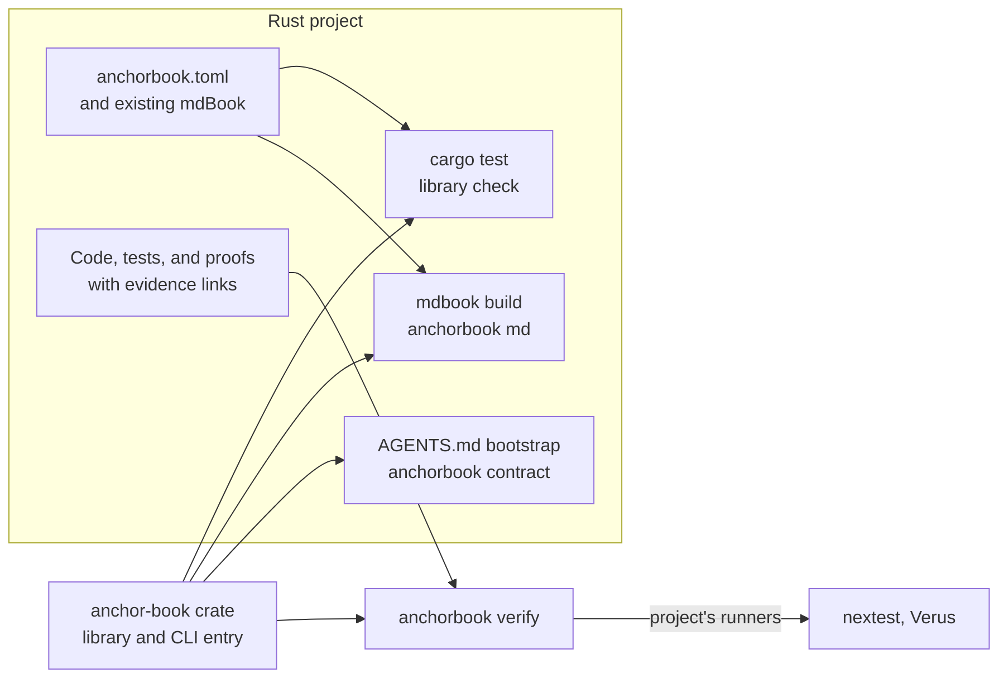

# Project Integration

**Status: draft for review.** Not implemented; the engine is currently used only
from its own checkout. This chapter defines how other Rust projects use Anchor
Book. Consumer proof evidence is proposed in the
[Verification Evidence roadmap](../implementation-roadmaps/verification-evidence.md#verification-evidence-5)
and engine proof isolation in the
[Formal Verification roadmap](../implementation-roadmaps/formal-verification.md#formal-verification-4).
[Later work](../implementation-roadmaps/index.md#later-work-retained-from-the-design)
records the remaining integration and release scope.

A project adopts Anchor Book by depending on the published crate and adding
configuration. Its ordinary tools then apply Anchor Book: `cargo test` checks
the Book, `mdbook build` renders its records, CI runs those same commands,
`anchorbook verify` reports evidence for its criteria, and its agents start
from the contract. The project keeps its own layout, commands, toolchains, and
dependencies. Verus is optional: a project that does not verify its code with
Verus needs neither Verus nor `vstd`, and `verify` reports its tests. A project
that does can use Anchor Book to formally verify its own code with Verus against
the proof criteria in its Book.

The engine directs how it is used; projects choose which integration points
they adopt. This Book is the first project; the cases below describe the
situations other projects bring.

## Anchors

```anchorbook-anchor
schema-version = 1
id = "project-native-commands"
title = "A project applies Anchor Book through its ordinary commands"
status = "draft"
property = '''
After a project adds the crate and its configuration, its own `cargo test`,
`mdbook build`, and CI apply Anchor Book checking and rendering without wrapper
scripts or replacement commands. A check run through the project's test suite
reaches the same outcome and findings as the CLI for the same Book, and a Book
that fails checking is not rendered.
'''
authorities = [
  { kind = "requirement", id = "requirement-project-adoption" },
  { kind = "decision", id = "decision-native-tool-integration" },
]

[[criteria]]
id = "consumer-fixture"
verification = ["test"]
statement = "A fixture workspace outside this repository depends on the crate as a package dependency. Its integration test and the CLI report the same outcome and findings for passing, failing, and incomplete Books, and its mdbook build with the preprocessor renders only the passing Book."
```

```anchorbook-anchor
schema-version = 1
id = "project-one-engine-version"
title = "Every entry point in a project runs the declared engine version"
status = "draft"
property = '''
A project declares one exact engine version. Its library calls, CLI invocations,
and mdBook preprocessor run that version, or stop before evaluating with a
diagnostic stating the declared and running versions. A missing, malformed, or
non-exact engine declaration, or a Book or configuration declaring an unsupported
schema or record-syntax version, produces an incomplete result, never a pass or
a partial interpretation.
'''
authorities = [
  { kind = "requirement", id = "requirement-project-adoption" },
  { kind = "decision", id = "decision-library-cli-entry" },
]

[[criteria]]
id = "same-version-entry-points"
verification = ["test"]
statement = "In a fixture workspace, a project-local binary built from the library and an installed binary of the same version produce identical reports; an installed binary of a different version stops with the declared and running versions."

[[criteria]]
id = "exact-version-declaration"
verification = ["test"]
statement = "Every entry point accepts an exact Cargo version requirement such as =0.2.0 and rejects missing, malformed, or non-exact declarations before evaluation. A different version is rejected even when it would satisfy a broader compatible range."

[[criteria]]
id = "unsupported-versions"
verification = ["test"]
statement = "Configurations and Books declaring unsupported schema or record-syntax versions produce incomplete results identifying the declared and supported versions."
```

```anchorbook-anchor
schema-version = 1
id = "project-no-imposed-dependencies"
title = "Depending on the engine does not constrain the project's own tools"
status = "draft"
property = '''
Adding the crate as a dependency builds no formal-verification library and adds
no exact-version requirement on a package that a project may use for its own
work, so a project can choose its Verus and vstd versions independently.
Ordinary builds need neither Verus nor the engine's verification toolchain, and
the engine builds with a project's pinned toolchain at or above its minimum Rust
version, including nightly. The mdBook versions the preprocessor supports are
declared, and an unsupported version fails with a diagnostic naming them.
'''
authorities = [
  { kind = "requirement", id = "requirement-project-adoption" },
  { kind = "decision", id = "decision-isolate-engine-verification" },
]

[[criteria]]
id = "independent-resolution"
verification = ["test"]
statement = "A fixture workspace that depends on the crate and on a different vstd version resolves and builds, and the crate's default dependency tree contains no vstd, Verus, or exact-version requirement on shared packages."

[[criteria]]
id = "dependency-review"
verification = ["review"]
statement = "Review the published dependency set and features against this property for each release, recording any exact-version requirement with its reason."

[[criteria]]
id = "renderer-versions"
verification = ["test"]
statement = "The preprocessor accepts each declared supported mdBook version and rejects an unsupported one with a diagnostic naming the supported versions."
```

```anchorbook-anchor
schema-version = 1
id = "project-agent-bootstrap"
title = "A project's agents start from the contract and the project's Book"
status = "draft"
property = '''
A project's agent bootstrap directs agents to read the working contract for the
project's engine version, then the project's guidance and Book. The contract is
retrieved from the engine and contains no project-specific content; project
state, paths, commands, and policies stay in the project's Book.
'''
authorities = [
  { kind = "requirement", id = "requirement-project-adoption" },
]

[[criteria]]
id = "contract-retrieval"
verification = ["test"]
statement = "anchorbook contract prints the contract packaged with the running engine version, without reading project files, and the output is identical for different projects."

[[criteria]]
id = "fresh-session"
verification = ["test", "review"]
statement = "Fresh agent sessions in a fixture project with the documented bootstrap section retrieve the contract, read the project guidance and Book, and identify the phase and supported commands; record agent versions and any assistance."
```

```anchorbook-anchor
schema-version = 1
id = "project-verus-evidence"
title = "A project's Verus proofs are evidence for its own criteria"
status = "draft"
property = '''
For a project whose criteria require proof, verify runs the project's own Verus
installation and verification toolchain over the project's code and reports a
proof method satisfied only when every function linked to the criterion verified
in a complete run under the configured no-trusted-assumption policy. The
engine's own proofs never count as evidence for a project's criteria, and a
Verus version whose report the engine does not support leaves the method
inconclusive.
'''
authorities = [
  { kind = "requirement", id = "requirement-project-verification" },
  { kind = "decision", id = "decision-isolate-engine-verification" },
]

[[criteria]]
id = "separate-toolchain"
verification = ["test"]
statement = "A fixture workspace with its own Verus version and a verification toolchain different from its build toolchain reports satisfied, failed, and inconclusive proof states from that installation."

[[criteria]]
id = "trusted-assumptions"
verification = ["test"]
statement = "Linked functions relying on assumed or trusted bodies, a partial-crate run, and an unsupported report version never produce a satisfied proof method."
```

## How a project uses Anchor Book



| Integration point | What the project adds | Operation |
| --- | --- | --- |
| Configuration | `anchorbook.toml` beside its mdBook configuration | All |
| Book check in tests | An integration test calling the library check | [Check](structural-checking.md) |
| Rendering | `anchorbook md` in its mdBook preprocessors | [Record Rendering](record-rendering.md) |
| CI | Nothing beyond its existing `cargo test` and `mdbook build` steps | Check, render |
| Evidence | Evidence links beside tests and proofs; a `[verification]` section | [Verify](verification-evidence.md) |
| Agents | A bootstrap section in `AGENTS.md` | Contract |

A project adopts any subset. Each integration point uses the same library and
configuration, so the results agree whichever one runs.

## Adding Anchor Book

The project adds the crate as a development dependency and an `anchorbook.toml`
at its workspace root, mapping its existing Book source, output, and section
roles as defined in [Configuration](configuration.md). Directory names, titles,
and the rest of the mdBook configuration remain the project's choices.

The required roles keep the [configured structure](structural-checking.md#check-navigation-conformance)
in every project: each maps to a distinct top-level chapter. An existing Book
whose design or decision material sits deeper in its navigation adds top-level
role chapters rather than mapping a role to a nested chapter, so every Anchor
Book has the same shape for agents and checks.

A new project can initialize the required structure. An existing project adopts:
the engine maps its Book into roles, reports what is missing, and applies agreed
changes; [Operations](system-overview.md#operations) defines both. Until
those operations exist, a project writes its configuration and required
chapters by hand and uses `check` to confirm them.

A project whose existing Book serves another purpose, such as user
documentation, keeps it and adds a separate Anchor Book with its own source and
[mdBook configuration](configuration.md#relationship-to-mdbook). Agents adapt the
project's existing design notes and decision records into the new Book's design
chapters, records, and roadmaps; the existing Book is not restructured.

A project with its own anchor or specification conventions replaces them with
records in the [record syntax](anchor-definitions.md#record-syntax), rewriting
or dropping them explicitly. The engine reads one canonical format; it does not
interpret other conventions or accept aliases for them.

## Running the engine

A dependency provides the library, but mdBook, CI, and agents invoke a binary,
and Cargo does not run binaries belonging to dependencies. The library therefore
exposes the CLI entry point, and the published `anchorbook` binary is a thin
wrapper around it. A project runs the engine in either of two ways:

| Way | Version source | Suited to |
| --- | --- | --- |
| A small binary in the project's workspace that calls the library entry point, with a Cargo alias | The project's `Cargo.lock`, shared with its tests | Workspaces that already run internal tools through Cargo |
| An installed `anchorbook` binary | The version installed by the project's setup and CI | Projects that prefer not to add a workspace member |

Until the crate is published, a project installs a pinned engine revision from
the repository, with the engine's own lock file:

```sh
cargo install --git https://github.com/anchor-book/anchor-book --rev <commit> --locked anchor-book
```

Its `book.toml` then runs the installed binary as the preprocessor command,
`anchorbook md`. This Book keeps its `cargo run` command so engine and Book changes
land together, and its CI installs the revision under test this way and requires
the same check findings, contract, and rendered Book as the in-repository build.

The project declares one exact engine version in `anchorbook.toml`. Every entry
point compares its own version with that declaration and stops before evaluating
when they differ, so a stale installation cannot silently check or render with
different rules than the project's tests.

```toml
[engine]
version = "=0.2.0"
```

The value must be an exact Cargo version requirement: `=` followed by a full
version. Missing, malformed, or non-exact declarations make evaluation incomplete.
This keeps all entry points on one version; upgrades update the declaration,
locked dependency, and installed binary together as applicable.

Configuration, record syntax, and the contract are versioned with the engine;
a Book declares the configuration schema and record syntax it uses, and an engine
that does not support them reports incomplete evaluation. Compatibility and
migration rules for those versions are part of
[release readiness](rust-engine.md#rust-development-conventions).

## What the crate must not impose

The engine is a development tool inside someone else's build, so its
dependencies are constraints on that build:

- **Formal verification.** The engine's own proofs, `vstd`, and the Verus
  toolchain stay out of what a project builds. A project that verifies its own
  code chooses its own Verus and vstd versions. The
  [proof packaging design](verified-code-packaging.md#proof-packaging-for-consumers)
  and its roadmap own that boundary.
- **Exact pins.** The published crate avoids exact-version requirements on
  packages a project may also use. Where an exact requirement is necessary, such
  as a parser whose behavior defines supported input, it is internal, recorded,
  and reviewed.
- **Toolchains.** The engine builds on the project's toolchain at or above its
  minimum Rust version, including pinned nightly toolchains. Verification
  toolchains are configured separately and never replace the project's build
  toolchain.
- **mdBook.** The preprocessor supports a declared set of mdBook versions and
  rejects others with a diagnostic naming them, so a project can upgrade mdBook
  deliberately. The set is currently 0.5.4, the newest release, because the
  checker's navigation parser and configuration defaults come from that version's
  crates; a project pins its mdBook to a declared version. Accepting newer 0.5.x
  releases could be justified later by a scheduled job that renders this Book with
  the newest mdBook and a warning when the running version is newer than the
  tested one; without them, a changed parser would silently diverge from the
  checker.
- **Layout and commands.** No fixed directory names, wrapper scripts, or
  replacement commands.

## Agent bootstrap

A project's `AGENTS.md` contains a short bootstrap section. It directs agents to:

1. Run `anchorbook contract` and read the output in full before project work.
2. Read the project's guidance chapter, which identifies its phase, commands,
   and authoring references.
3. Read the Book's `SUMMARY.md` and every chapter it lists.

The contract comes from the engine version the project declares; no generated
copy is checked in. Project-specific instructions belong in the guidance chapter,
not in the contract or a modified copy of it. Other agent integrations, such as a
skill that retrieves the contract, follow the same three steps.

Initially the engine documents the section as a template that the project adds by
hand. Initialization and adoption can later write it as managed content.

## Formal verification in a project

A project uses Anchor Book to verify its own code: its anchors declare proof
criteria, its specifications and proofs live with its production code, and
`verify` reports which criteria those proofs establish. The engine adds what
Verus alone does not: the association between proofs and criteria, selection
of the proofs in scope, the [guards](verification.md#guards) that check a proof
establishes its criterion, and an evidence state that never overstates a result.
[Verification](verification.md) defines that capability.

The project configures its Verus installation and verification toolchain in its
[verification configuration](verification-evidence.md#configuration), separate
from its build toolchain. `verify` runs that installation, reads its report, and
checks that every linked function verified in the complete selected target under
the recorded trust policy. The [Verus runner design](verification-evidence.md#verus-runner)
defines mode-aware matching, complete reports, assumptions, and failure states.
An unsupported report version is inconclusive.

A proof criterion's scope (claim, domain, boundary, assumptions, and
exclusions, as defined in [Anchor Definitions](anchor-definitions.md#required-scope-of-a-proof-criterion))
remains the project's statement of what the proof must establish. The engine
checks what it can observe from the run and its guards; whether the
specification faithfully expresses the criterion stays a review obligation,
recorded in a [assessment record](verification.md#assessment-records).

The engine's proofs of its own logic, such as its
[authority proof](rust-engine.md#authority-proof), are evidence only for this
Book's criteria.

The first consumer fixtures use a packaged dependency outside this checkout:
ordinary builds need no engine verifier, and a project with its own `vstd` uses
its own Verus installation and a verification toolchain separate from its build
toolchain. Proof success, deliberate failure and correction, unsupported reports,
and excluded integration boundaries are acceptance cases in
[Verification Evidence milestone 5](../implementation-roadmaps/verification-evidence.md#verification-evidence-5).
These fixtures can use a locally packaged release candidate before registry
publication. CLI version alignment and contract delivery remain separate
integration work.

## Projects as acceptance cases

The engine's acceptance cases include independent fixture workspaces with
different layouts, existing Books, multi-crate workspaces, pinned toolchains, and
their own Verus versions. Trials in other projects use disposable copies or
branches and record findings in this Book's roadmaps. Design chapters describe
situations, not the projects they came from; the
[Project Integration](../implementation-roadmaps/project-integration.md) and
[Symposium Integration](../implementation-roadmaps/symposium-integration.md)
roadmaps name the projects they integrate.

## Open questions

1. **Implementation associations.** Whether evidence links extend from tests and
   proofs to implementation sites, with explicit not-yet-implemented and
   not-applicable states.
2. **Supported Verus versions.** How wide a report-version range the engine can
   maintain, and how a project learns of the supported range.
3. **Bootstrap ownership.** Whether initialization writes and checks the
   `AGENTS.md` section as managed content, or the project maintains it from the
   template.
