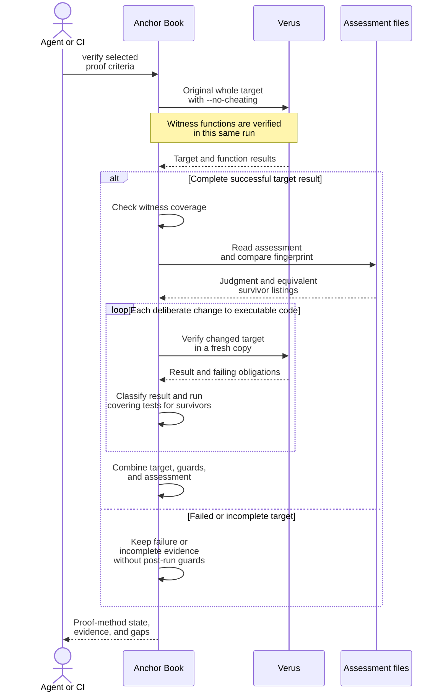

# Proof Guards

A [proof guard](verification.md#guards) checks what a successful Verus result
alone does not establish. This page shows when those checks happen and which
steps call Verus.

For the engine's implemented workflow, see
[Proof verification today](../working-on-anchor-book.md#proof-verification-today).

## When guards are checked

Guards are evaluated when an agent or CI asks `verify` to evaluate a proof
criterion. They are development and CI checks, not checks performed each time the
application calls a verified function. The checks use Verus results, additional
Verus runs, and recorded judgments at different points:

| When | Check | Work performed |
| --- | --- | --- |
| During the original Verus run | Trust policy | `--no-cheating` rejects project assumptions and trusted bodies. |
| After the original target verifies completely | Witness coverage | Check that each linked function with preconditions has a witness verified in that same run. The witness's proof was checked by Verus; Anchor Book checks its association and result. |
| After the original target verifies completely | Current specification assessment | Compute the current fingerprint and read the reviewer's record. Check its subject, fingerprint, conclusion, and scope. This reads a judgment already recorded; it does not summon a reviewer. |
| After the original target verifies completely | Sensitivity | Make deliberate changes to executable code in fresh copies and run Verus again for each change. Classify survivors using the covering tests and current assessment. |
| When all required results are available | Proof-method state | Combine the target result, witness coverage, sensitivity, and assessment. Only complete passing evidence satisfies the proof method. |

The original code's verification must succeed before the post-verification
stage starts. The [execution diagram](#execution-sequence)
shows the additional Verus calls. A sensitivity run checks a deliberately changed
copy; the project's source files, contracts, and proofs stay unchanged.

For example, the authority validator can pass its original proof. Sensitivity
then changes its accepted-status check to always pass in a disposable copy and
asks Verus to verify that copy. Rejection by the relevant contract shows that the
proof detects this defect; a surviving change needs the
[survivor classification](verification-evidence.md#proof-guards). The first
passing run alone supplies no sensitivity result.

A reviewer creates or updates the specification assessment during development,
using the criterion, contracts, call paths, and observed results. Each `verify`
run checks whether that record is still applicable. An unchanged specification
fingerprint can retain its assessment; code changes still require fresh
verification and sensitivity checks. A changed fingerprint requires a new
assessment before the method can be satisfied.

`anchorbook proof` is the [target gate](verification-evidence.md#ci-proof-gate):
it stops at the original target's result and does not establish these additional
obligations. `verify` reports the complete proof method and any other methods the
criterion requires. See [project guidance](../working-on-anchor-book.md#proof-verification-today)
for the implemented portion of this workflow.

## Execution sequence

The post-verification [guard stage](#when-guards-are-checked)
starts after a complete successful target result. The trust policy is already
enforced during that original Verus invocation, and witness functions in the
target are verified in that run. Anchor Book then checks witness coverage,
assessment currency, and sensitivity for the proof criteria in scope.
`anchorbook proof` stops at the target gate; this diagram shows the complete
`verify` workflow.

The record-reading step consumes a reviewer's existing assessment; review is a
separate activity. Missing or stale records do not become accepting judgments.
The sequence details one proof method; the criterion's required test and review
methods keep their own results. The surrounding [Book build](verification-evidence.md#book-build-evidence)
consumes the evaluated report before rendering, without starting verification
again inside the renderer.
