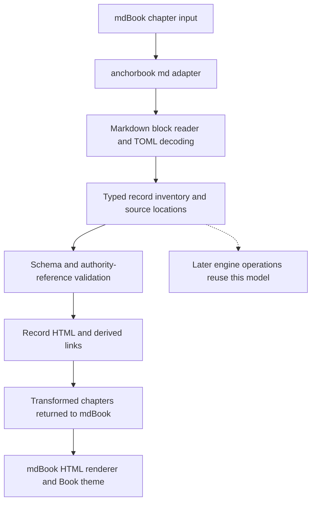
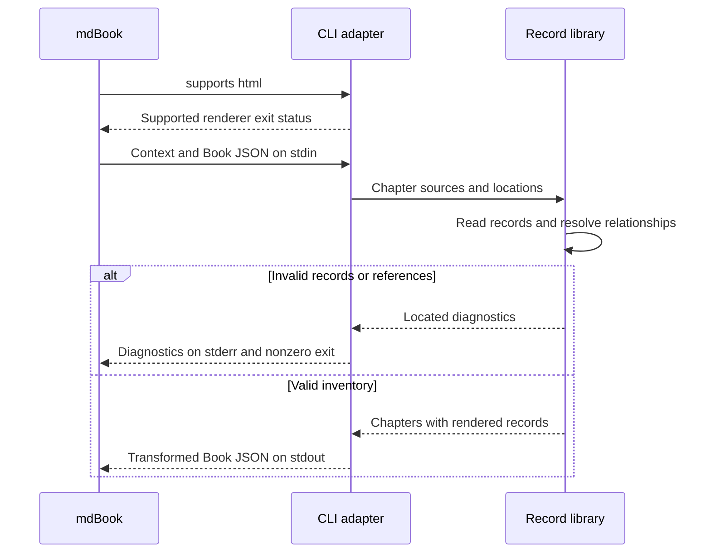

# Record Rendering

**Status: prototype implemented locally.** The record library, mdBook adapter,
and readable HTML presentation are implemented. Local rendering and acceptance
checks pass; remote workflow verification remains in milestone 3.

Anchors, requirements, and decisions stay in their canonical TOML blocks in the
source. In the rendered Book, they become readable sections with permalinks,
status labels, authority links, and derived backlinks. Schema examples remain
literal code examples. Rendering does not establish implementation or verification.

## Anchors

```anchorbook-anchor
schema-version = 1
id = "render-records-in-context"
title = "Structured records become readable linked content"
status = "draft"
property = '''
The rendered Book presents each authored anchor, requirement, and decision in
its chapter with its complete statement, identity, acceptance status, and the
supporting fields defined for its kind. Authority links and derived backlinks
resolve to the corresponding record. Literal schema examples remain code.
Rendering preserves source files and does not imply implementation or verification.
'''
authorities = [
  { kind = "requirement", id = "requirement-readable-records" },
  { kind = "decision", id = "decision-shared-record-rendering" },
]

[[criteria]]
id = "record-presentation"
verification = ["test", "review"]
statement = "Compare the authored inventory and fields with generated records; every definition is represented once per chapter, all fields are accessible, and nested examples remain literal. Review light, dark, narrow, keyboard, and print presentation."

[[criteria]]
id = "relationship-navigation"
verification = ["test"]
statement = "Exercise direct links and derived backlinks across nested chapters, localhost, a project site prefix, and the combined print view; fragments identify the intended record."

[[criteria]]
id = "preservation-and-escaping"
verification = ["test"]
statement = "Compare source files before and after preprocessing and Book builds; they are unchanged. Fixtures containing HTML/script-like field text render it inertly, and unrelated prose and diagrams are preserved."
```

```anchorbook-anchor
schema-version = 1
id = "render-validated-records"
title = "Rendering uses one validated record inventory"
status = "draft"
property = '''
The library parses the canonical record formats and resolves typed authority
relationships before the mdBook adapter emits transformed Book JSON. Invalid
definitions or relationships fail preprocessing with located diagnostics; they
cannot be skipped to produce a successful partial Book. Rendering and reference
validation use the same record identities and model.
'''
authorities = [
  { kind = "requirement", id = "requirement-readable-records" },
  { kind = "decision", id = "decision-shared-record-rendering" },
]

[[criteria]]
id = "invalid-inventory"
verification = ["test"]
statement = "Independent fixtures cover malformed fences/TOML, missing and unknown fields, duplicate IDs across kinds, dangling/wrong-kind/repeated references, and accepted records citing drafts; each fails with the expected located diagnostic."

[[criteria]]
id = "protocol-and-independence"
verification = ["test", "review"]
statement = "Exercise the actual adapter process with valid and malformed mdBook input and supported/unsupported renderer probes. Success returns valid complete Book JSON; preprocessing failure returns nonzero with stderr diagnostics and no success JSON. Build and fixture tests work without a valid or rendered Book."
```

## Approach

Record parsing and validation are separate from presentation. Canonical TOML
blocks define record identities, authority relationships, and verification criteria.
The shared library collects and validates that inventory before it can be rendered.

mdBook invokes `anchorbook md` with chapter input. The adapter calls the library's
`rendering` operation, which uses `records` to validate the definitions and then
replaces their source ranges with readable HTML in memory. The adapter returns
the transformed Book to mdBook for normal HTML generation. Separate indexes,
evidence pages, Rust source associations, and progress reporting are later work.

## Components



The single [Rust package](rust-engine.md#internal-boundaries) contains the library
and CLI. The library owns record reading, validation, indexing, and presentation.
The adapter translates mdBook's protocol and chapter data; it does not define
another parser or reference resolver. Keep implementation modules private until
callers need a public interface. [Rust Engine](rust-engine.md#implemented-record-api)
documents the implemented API.

The input inventory is the chapters supplied by mdBook, including nested and
unnumbered chapters with source paths. Record validation does not require the
not-yet-implemented `anchorbook.toml` reader. File paths identify source locations
and output routes, not record identity. Reject a definition in a chapter without
a usable source/output location rather than inventing a destination.

## Reading and validation

Use a Markdown parser with source offsets to locate top-level definition blocks.
Validate their canonical fences as well as their TOML contents, following
[Anchor Definitions](anchor-definitions.md) and [Authority Definitions](authority-definitions.md).
Keep ordinary examples, code literals, and surrounding prose outside the record
inventory. Invalid recognized blocks must not disappear silently.

Collect the whole inventory before resolving relationships. Reject malformed
records, duplicate identities, missing or wrong-kind targets, repeated references,
and incompatible acceptance states using the same model that drives rendering.
Do not render a successful partial Book when that validation fails.

Return typed diagnostics with a stable code, chapter path, available source
position, explanation, and related definition location where useful. Order them
by chapter path, source position, then code. The prototype's diagnostic families
are `record.invalid-input`, `record.invalid-definition`, `record.duplicate-id`,
`record.invalid-reference`, `record.incompatible-status`, and
the adapter code `render.invalid-input`. The record input code covers
missing or repeated chapter paths. Refine detailed messages during implementation;
do not reuse structural-check codes for a different rule scope.

These checks establish record and relationship consistency. They do not validate
the Book's configured layout, prove that an authority logically supports a
property, enforce project-phase transitions, or run verification criteria.

## Reader presentation

Use a consistent visual treatment that fits within ordinary chapter prose.
Keep the main statement visible and readable at normal text size. Status must
be conveyed by words, not color alone. Identifiers remain visible but secondary.

| Record | Always visible | Supporting detail |
| --- | --- | --- |
| Anchor | Title, identifier/permalink, Draft or Accepted, complete property, linked authorities, verification criteria with their required methods | Derived relationships when applicable |
| Requirement | Title, identifier/permalink, status, requirement statement, source | Derived links to anchors and decisions that cite it |
| Decision | Title, identifier/permalink, status, choice, linked requirements | Expandable rationale, alternatives, and reconsideration conditions; derived links to citing anchors |

Render links with readable titles and identifiable targets. An empty decision
requirements list is shown explicitly as no recorded requirements. Derive
backlinks from the referencing records; do not maintain two relationship sources.
Sort backlink lists deterministically. Acceptance labels do not become
"implemented", "tested", or "verified" badges.
Each criterion shows its authored methods as **Required verification**, with all
methods required. These labels are obligations, not results from running tools.

Each record owns the fragment matching its identifier. Generate chapter-relative
links so navigation works on localhost and under the GitHub Pages project prefix.
Encode paths and escape generated attributes. Verify links across chapter depths
and in mdBook's combined print view; the print view must link to the matching
record in that view. Preserve existing public record fragment names when replacing
the temporary HTML targets.

The prototype treats record text as escaped text with paragraph breaks, not raw
HTML. Text resembling tags or scripts must stay inert. Inline Markdown formatting
inside field strings is outside this first presentation scope. The authoring
schema still permits ordinary strings; richer formatting can be designed later.

Use mdBook theme variables for light and dark themes, visible keyboard focus,
wrapping identifiers, and narrow layouts. Expandable details use keyboard-accessible
controls, and their contents must be available when printing. No browser runtime
parser, remote badge service, or external script is required to read the records.

## mdBook integration

Implemented command: `anchorbook md`. The local `book.toml` invokes
`cargo run --quiet --locked --bin anchorbook -- md`, after mdBook's `links`
preprocessor and before Mermaid. The prototype requires mdBook **0.5.2** and
supports HTML only. The adapter uses `serde_json` to validate the needed protocol
fields while preserving navigation and unknown metadata. It does not depend on
the mdBook crate or launch a nested Book build.

`rendering::render_chapters` accepts supplied sources and output routes; it calls
the shared record reader and returns transformed chapter strings or typed errors.
Output routes must be nonempty, relative UTF-8 paths without traversal, backslashes,
control characters, or colon-based schemes. Their HTML destinations must be
unique. Every supplied chapter needs source and output paths, including unnumbered
chapters; draft chapters without paths are currently rejected.

Generated links are relative and percent-encode path components. mdBook 0.5.2
rewrites these HTML links into fragment links in its combined print view. The
local theme opens decision details in that view and during browser printing.
No record parsing runs in the browser. Formatting, source wrapping, and repeated
blank lines within prose are normalized for readable paragraphs.

The existing engine workflow tests the crate separately. Milestone 3 will reconcile
and verify the complete CI rendering path; no remote result is claimed here.



The capability probe rejects unsupported renderers. Preprocessing success writes
only complete Book JSON to stdout; failures write diagnostics to stderr and exit
nonzero without partial JSON. These statuses are separate from `anchorbook check`.

Replace definition-block ranges in memory. Preserve the rest of each chapter and
the Book's navigation metadata. Require no writes to source files, recursive
Book builds, subprocess verification, or dependency fetching by the adapter.
Choose and test preprocessor ordering with Mermaid so examples and diagrams
retain their intended meaning.

Replacing manual headings, targets, and relationship lists with generated
versions is an explicit source migration. Preserve prose and logical section
headings; the preprocessor does not perform that migration.

## Acceptance and boundaries

Use the current Book's complete record inventory as the main presentation case,
supplemented by independent fixtures. The [Record Rendering roadmap](../implementation-roadmaps/record-rendering.md)
defines the implementation and acceptance work.

Engine compilation and fixture tests must succeed with an invalid or unrendered
Book. The prototype CI order is compile/test, then mdBook with the record adapter.
Structural checking will later add its separate acceptance step before rendering.
This prototype does not implement `anchorbook check`, materialization, contract
generation, cross-Book authorities, or evidence aggregation.
