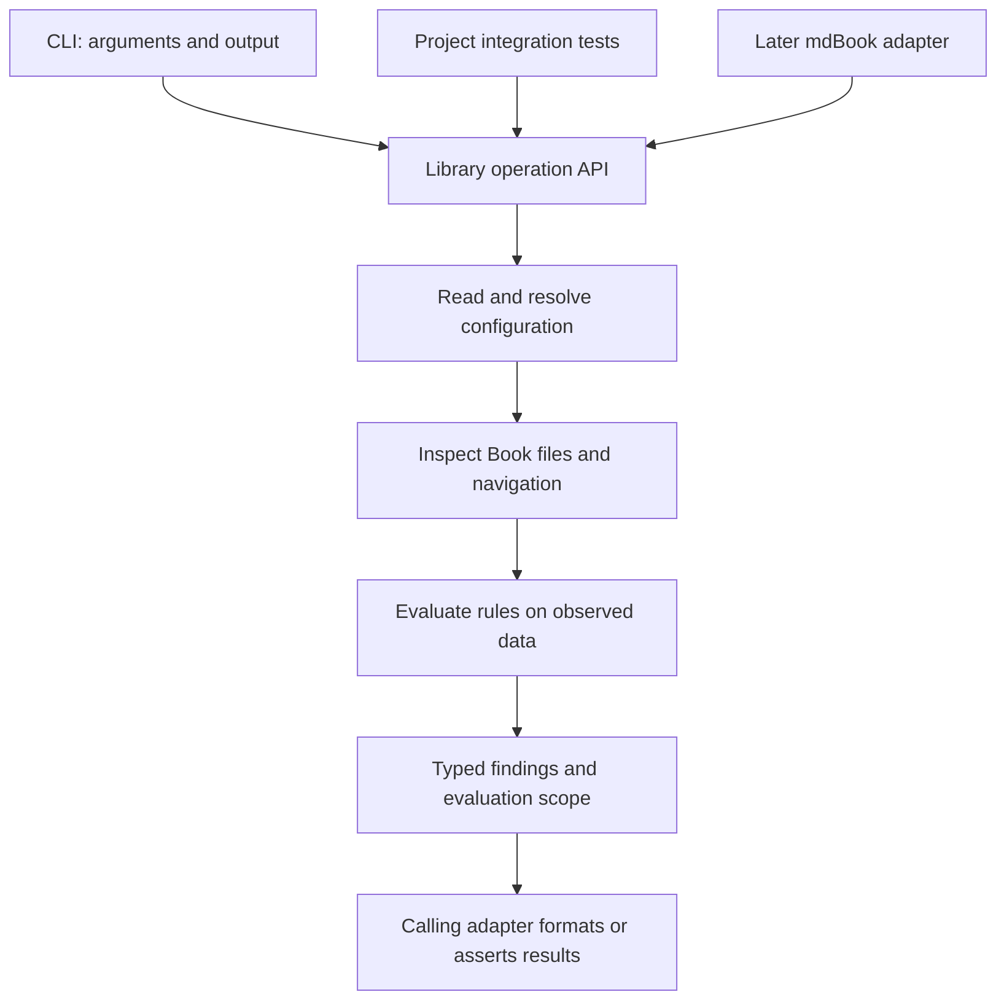

# Rust Engine

**Status: draft for review.** These are design boundaries, not an implemented API.

## Package and adapters

Start with one Cargo package containing a library and a CLI. Working names are
package `anchor-book`, library `anchor_book`, and executable `anchorbook`.
Confirm registry availability before release. Multiple crates are justified only
when actual dependency or release requirements call for them.

The library owns configuration resolution, the Book model, rules, findings, and
operations. The binary handles arguments, presentation, streams, and exit status.
A project integration test calls the library directly. The later mdBook adapter
translates between mdBook's protocol and the shared model.

Cargo supports [library and binary targets in one package](https://doc.rust-lang.org/cargo/reference/cargo-targets.html);
the binary uses the library's public API.

## Internal boundaries

Begin with ordinary private modules, exposing only the types callers need.

| Boundary | Responsibility |
| --- | --- |
| Configuration | Deserialize input, validate its schema, and resolve paths and roles |
| Book inspection | Read files and parse navigation, retaining relevant source locations |
| Rules | Evaluate observed data without further filesystem access |
| Diagnostics | Represent findings, scope, and operational failures |
| Operations | Coordinate the preceding pieces for each supported operation |

Keep raw deserialization types separate from validated configuration. A caller
must not construct an apparently resolved configuration with unchecked fields.
Use private fields and validated construction where invariants matter.

Use `Path` and `PathBuf` for filesystem paths; text displayed to users is not a
path identity. Use enums for the initial finite set of section roles and result
states. Borrow inputs when an operation only needs to inspect them; own the
data that must survive in a returned report.

Start with synchronous Rust and explicit inputs. Avoid global configuration,
changing the process working directory, and a speculative plugin framework.
Internal data structures need not become public extension interfaces.

## Results and errors

A successfully completed check returns a report, even if that report contains
structural violations. Missing required files follow the structural rules;
unexpected read failures and inputs that cannot be interpreted are operational
errors. A caller must distinguish these cases without parsing prose.

The conceptual interface is an explicit configuration path producing
`Result<CheckReport, CheckError>`. Exact signatures and type names will be
settled during implementation. A report includes the findings and evaluated
scope. An error identifies the failed operation and location and can retain
findings collected before the failure; these are partial, not a complete report.

Public errors implement `std::error::Error` and `Display`, preserving underlying
causes where applicable. Library functions do not print, exit the process, or
panic for malformed user input. The CLI owns presentation and status mapping.
Do not expose parser-specific types as the public diagnostic contract.

Return findings in a documented stable order, independent of filesystem
enumeration. Stable rule identifiers support assertions and integrations;
human wording can improve without changing rule identity. A serialized report
format would be a separately versioned interface, not an accidental dump of
internal types.

The [diagnostics design](check-diagnostics.md) defines the information carried
by these types and its CLI presentation. Keep diagnostic code, kind, locations,
expected/found conditions, help, and per-check outcomes available as data rather
than requiring Rust callers to parse rendered messages.

## Rust development conventions

Keep the public surface small and document its behavior, errors, and examples.
Use standard traits where they have useful semantics; do not add traits or
generic parameters merely to anticipate future integrations. These choices
follow the [Rust API Guidelines](https://rust-lang.github.io/api-guidelines/checklist.html).

Before the first implementation is accepted:

- Select the Rust edition and declare the minimum supported Rust version after
  checking dependency requirements; exercise that version and stable Rust in CI.
- Choose focused dependencies for TOML, argument parsing, and navigation parsing.
  Keep dependency choices and versions explicit in the implementation review.
- Run formatting, Clippy, unit and integration tests, and documentation tests
  for usable public examples.
- Test rule behavior with independent expected results, and test CLI status and
  file preservation through its actual process boundary.

The navigation reader should reuse mdBook's summary semantics where practical.
Compare the supported mdBook parser API and dependency cost before choosing its
implementation; regex matching is not a substitute for a navigation parser.
Using a parser must not invoke preprocessors or mdBook's file-creating loader.

Package the required public core resources with the crate when those resources
are introduced. Installation must work without this development checkout.
Publishing metadata, license expression, packaged files, and compatibility
policy are part of release readiness.

## Choices still open

The initial implementation review must settle dependency versions, supported
mdBook versions, Rust version support, and exact public API shapes. The first
checker does not need an asynchronous runtime, dynamic rule registration, or
test-verifier execution APIs. Those require concrete workflows before design.
