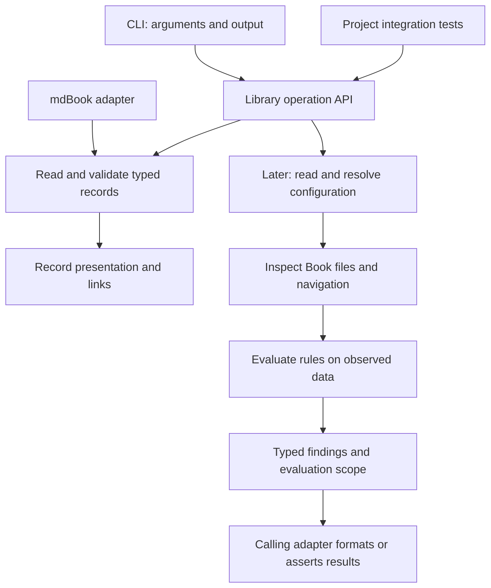

# Rust Engine

**Status: prototype implementation in progress.** The record library described
below is implemented, along with record rendering and the mdBook adapter.
Configuration and structural checking remain design drafts.

## Package and adapters

The repository has one Cargo package containing a library and a CLI: package
`anchor-book`, library `anchor_book`, and executable `anchorbook`.
Confirm registry availability before release. Multiple crates are justified only
when actual dependency or release requirements call for them.

The library owns configuration resolution, the Book model, rules, findings, and
operations. The binary handles arguments, presentation, streams, and exit status.
A project integration test calls the library directly. The initial mdBook adapter
translates between mdBook's protocol and the shared record model.

[Record Rendering](record-rendering.md) is the first implementation increment.
It establishes this package, canonical record parsing, authority resolution, and
HTML presentation through `anchorbook md`. The configuration reader and
`anchorbook check` follow. Compiling the crate requires neither a valid Book nor
rendered output; this order introduces no build-time dependence on the Book.

Cargo supports [library and binary targets in one package](https://doc.rust-lang.org/cargo/reference/cargo-targets.html);
the binary uses the library's public API.



## Internal boundaries

Organize the library by capability from the start. Each capability exposes a
small interface and owns private implementation modules. Keep one Cargo package
until dependency or release requirements justify splitting it.

The implemented layout is:

```text
src/
  lib.rs                  Library entry point and initial API re-exports
  main.rs                 CLI entry point
  adapters.rs             External protocol interfaces
  adapters/mdbook.rs       JSON input, validation, and Book transformation
  rendering.rs            Record rendering operation and typed errors
  rendering/              Private HTML and link generation
  records.rs              Public record capability interface
  records/
    model.rs              Record types and chapter input
    markdown.rs           Canonical block recognition
    schema.rs             TOML decoding and schema validation
    inventory.rs          Identity, reference resolution, and backlinks
    diagnostics.rs        Record-specific findings and source locations
```

New work adds capability modules when implemented: `configuration`, `checking`,
`materialization`, and `contract`. Record presentation is in `rendering`; external
protocol handling is under `adapters`, beginning with the mdBook adapter. Do not create empty modules
or mix new capabilities into the record parser merely because it was built first.

The dependency direction is from operations and adapters toward shared models
and validation. `records` does not depend on rendering, command handling, or
mdBook. The rendering operation uses the record reader to obtain a validated inventory,
then presents it. The mdBook adapter translates input into that operation and owns
protocol serialization; the CLI owns process streams and exit statuses.
Record diagnostics remain within `records`; extract shared diagnostic primitives
only when another implemented capability demonstrates the need.

Callers can use `anchor_book::records`. The initial crate-root re-exports remain
available. Internal record modules use their capability's interface, and their
construction details are visible only within that capability.

| Boundary | Responsibility |
| --- | --- |
| Configuration | Deserialize input, validate its schema, and resolve paths and roles |
| Book inspection | Read files and parse navigation, retaining relevant source locations |
| Records | Read canonical blocks from supplied chapter text, decode typed records, and resolve authority relationships |
| Rules | Evaluate observed data without further filesystem access |
| Diagnostics | Represent findings, scope, and operational failures |
| Presentation | Render validated records and derived relationships without changing source files |
| Operations | Coordinate the preceding pieces for each supported operation |

Keep raw deserialization types separate from validated configuration. A caller
must not construct an apparently resolved configuration with unchecked fields.
Use private fields and validated construction where invariants matter.

Use `Path` and `PathBuf` for filesystem paths; text displayed to users is not a
path identity. Use enums for the initial finite set of section roles and result
states. Borrow inputs when an operation only needs to inspect them; own the
data that must survive in a returned report.

Start with synchronous Rust and explicit inputs. Avoid global configuration,
changing the process working directory, and a speculative plugin framework.
Internal data structures need not become public extension interfaces.

## Implemented record API

`read_records(&[Chapter<'_>]) -> Result<RecordInventory, RecordErrors>` is the
first library operation. `Chapter` borrows a path and source string; the caller
supplies the chapter inventory. Paths must be nonempty and unique. The operation
does not open files, load configuration, invoke mdBook, or run verification.

The returned inventory owns its validated data. Its private fields prevent
callers from bypassing validation; `get`, `records`, and `backlinks` expose read
access. Records retain typed anchor, requirement, or decision data, definition
and body byte ranges, and locations for authority references. A later renderer
can replace exactly those blocks and resolve links from the same inventory.
Backlinks contain sorted, unique IDs of direct referring records.

The internal modules separate Markdown recognition, schema decoding, record
models, inventory resolution, and diagnostics. Raw Serde types remain private.
Public types use standard `Path`/`PathBuf`, enums, borrowed inputs, owned results,
and `std::error::Error`; parser-specific types are not API requirements.

An invalid inventory returns diagnostics, never a partially validated inventory.
Each diagnostic exposes a stable code, typed problem, explanation, source
location, related locations, and a parser cause when available. Byte ranges are
half-open; lines and Unicode-scalar columns are one-based. Diagnostics are sorted
by path, byte position, code, and message. Record iteration is sorted by identity.
Both orders are independent of the caller's chapter order.

Invalid definitions retain their identity when it can be decoded reliably.
References to those definitions report an invalid target, rather than a missing
one. When a malformed definition's identity cannot be recovered, unresolved
references report that resolution is blocked by invalid input. Duplicate
identities never select an arbitrary winner.

### Toolchain and dependencies

The package uses **Rust 2024**, with **Rust 1.85** as its declared minimum.
Local verification covers 1.85 and 1.90. The engine workflow targets 1.85 and
stable; a remote run is still pending publication of this work.

| Dependency | Purpose |
| --- | --- |
| `pulldown-cmark` 0.13 | Parse Markdown events and source offsets; recognize definitions without regex extraction |
| `toml_edit` 0.25, with `parse` and `serde` | Preserve TOML forms and spans, enforce inline authorities and `[[criteria]]`, and decode the same document into typed records |
| `serde` 1.0 | Decode private schemas with required fields and rejection of unknown fields |
| `serde_json` 1.0 | Decode and encode mdBook protocol data while preserving unknown metadata |

`Cargo.lock` records the exact tested dependency versions. The adapter targets
only the repository's pinned **mdBook 0.5.2** preprocessor protocol and rejects
other versions explicitly. No mdBook dependency or rendered Book is needed to
compile or test the library. The CLI handles `md`, renderer capability probes,
help, and version with a small explicit argument dispatch. Argument-parsing
dependencies can be reconsidered as more commands are implemented.

The public API and schema version 1 remain prototypes. The crate has
`publish = false` until release metadata, packaging, and compatibility policy
are ready. Authority schema changes must update the design, records, and tests
together; schema flexibility does not mean accepting alternate current formats.

## Results and errors

The first record operations accept supplied chapter text and locations, returning
a validated inventory or located diagnostics. Rendering accepts that inventory;
it does not re-parse definitions or independently resolve relationships. The
mdBook adapter owns JSON serialization, stderr reporting, and protocol exit
statuses. These do not imply the checking operation below is already implemented.

A successfully completed check returns a report, even if that report contains
structural violations. Missing required files follow the structural rules;
unexpected read failures and inputs that cannot be interpreted are operational
errors. A caller must distinguish these cases without parsing prose.

The conceptual interface is an explicit configuration path producing
`Result<CheckReport, CheckError>`. Exact signatures and type names will be
settled during implementation. A report includes the findings and evaluated
scope. An error identifies the failed operation and location and can retain
findings collected before the failure; these are partial, not a complete report.

Public errors implement `std::error::Error` and `Display`, preserving underlying
causes where applicable. Library functions do not print, exit the process, or
panic for malformed user input. The CLI owns presentation and status mapping.
Do not expose parser-specific types as the public diagnostic contract.

Return findings in a documented stable order, independent of filesystem
enumeration. Stable rule identifiers support assertions and integrations;
human wording can improve without changing rule identity. A serialized report
format would be a separately versioned interface, not an accidental dump of
internal types.

The [diagnostics design](check-diagnostics.md) defines the information carried
by these types and its CLI presentation. Keep diagnostic code, kind, locations,
expected/found conditions, help, and per-check outcomes available as data rather
than requiring Rust callers to parse rendered messages.

## Rust development conventions

Keep the public surface small and document its behavior, errors, and examples.
Use standard traits where they have useful semantics; do not add traits or
generic parameters merely to anticipate future integrations. These choices
follow the [Rust API Guidelines](https://rust-lang.github.io/api-guidelines/checklist.html).

For each implementation increment:

- Keep the declared minimum Rust version compatible with dependencies; exercise
  that version and stable Rust in CI.
- Choose focused dependencies for TOML, argument parsing, Markdown parsing, and
  the mdBook protocol; add navigation-reader dependencies when checking is built.
  Keep dependency choices and versions explicit in the implementation review.
- Run formatting, Clippy, unit and integration tests, and documentation tests
  for usable public examples.
- Test rule behavior with independent expected results, and test CLI status and
  file preservation through its actual process boundary.

The navigation reader should reuse mdBook's summary semantics where practical.
Compare the supported mdBook parser API and dependency cost before choosing its
implementation; regex matching is not a substitute for a navigation parser.
Using a parser must not invoke preprocessors or mdBook's file-creating loader.

Package the required public core resources with the crate when those resources
are introduced. Installation must work without this development checkout.
Publishing metadata, license expression, packaged files, and compatibility
policy are part of release readiness.

## Choices still open

The record library and adapter establish the initial toolchain, parser, and
protocol choices. Structural checking will
settle configuration and navigation-reader dependencies and APIs. The first
checker does not need an asynchronous runtime, dynamic rule registration, or
test-verifier execution APIs. Those require concrete workflows before design.

## Anchor

This draft uses the [structured anchor format](anchor-definitions.md).
Implementation and verification evidence are pending.

```anchorbook-anchor
schema-version = 1
id = "check-shared-typed-results"
title = "All callers use shared rules and typed results"
status = "draft"
property = '''
The Rust library owns checking behavior and exposes findings, locations, scope,
and errors as typed data. The CLI obtains its results through that library and
only handles invocation and presentation. Library callers can distinguish
structural failure from incomplete evaluation without parsing display text;
malformed user input does not cause the library to print, exit, or panic.
'''
authorities = [
  { kind = "requirement", id = "requirement-shared-checker" },
  { kind = "decision", id = "decision-typed-check-results" },
]

[[criteria]]
id = "equivalent-callers"
statement = "Exercise the library and actual CLI process on the same passing, failing, and incomplete fixtures; assert equivalent codes, locations, and evaluated scope against independent expectations."

[[criteria]]
id = "library-boundary"
statement = "Inspect errors through public types and preserved causes; exercise malformed inputs through a library caller and verify returned errors with no output, process exit, or panic."
```
