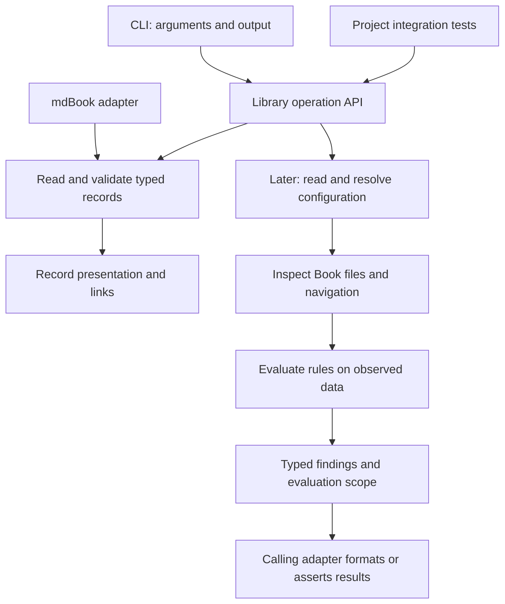

# Rust Engine

**Status: prototype implementation in progress.** The record library described
below is implemented, along with record rendering and the mdBook adapter.
Configuration and structural checking remain design drafts.

## Anchors

```anchorbook-anchor
schema-version = 1
id = "engine-valid-authority"
title = "Every anchor resolves to valid authority"
status = "draft"
property = '''
The engine validates an anchor only when it cites at least one requirement or
design decision and every authority reference resolves unambiguously to a valid
record of the declared kind. An accepted anchor may cite only accepted
authorities. Invalid authority relationships produce diagnostics rather than a
successfully validated inventory.
'''
authorities = [
  { kind = "requirement", id = "requirement-traceable-properties" },
]

[[criteria]]
id = "required-authority"
verification = ["test"]
statement = "Accept anchors with a valid requirement or design decision reference; reject missing or empty authority lists with an invalid-definition diagnostic."

[[criteria]]
id = "resolved-authority"
verification = ["test"]
statement = "Use independent fixtures with missing, wrong-kind, invalid, and ambiguous authority targets; return the expected located diagnostics and no validated inventory."

[[criteria]]
id = "compatible-status"
verification = ["test"]
statement = "Accept draft anchors citing draft or accepted authorities and accepted anchors citing accepted authorities; reject accepted anchors citing draft authorities with an incompatible-status diagnostic."

[[criteria]]
id = "formal-authority"
verification = ["proof"]
statement = '''
Claim: The production authority validator reports no violations if and only if
every successfully decoded record satisfies the authority rules: nonempty anchor
authority, distinct references, unique valid targets of the declared kind, and
compatible acceptance states, including requirements cited by uncited decisions.

Domain: The complete typed candidate collection, including empty authority lists,
duplicates, missing or invalid targets, unknown identities, and incompatible
statuses. Invalid relationships must not be excluded from the domain.

Boundary: Executable authority-presence checks, target lookup, and validation
across all records and references used by the engine.

Assumptions: The verifier, solver, compiler, and standard-library contracts are
trusted. No precondition may assume valid authority relationships. Decoding and
conversion fidelity are integration obligations outside this proof.

Exclusions: Parsing, candidate conversion, global identity checks, diagnostic
classification and locations, inventory construction, and adapter failure
propagation are covered by production-integration through tests and review.
'''

[[criteria]]
id = "production-integration"
verification = ["test", "review"]
statement = "The engine executes the verified authority-validation functions. Tests and review establish faithful parsing and candidate conversion, preserving identities, kinds, statuses, references, and invalid candidates. Global identity checks remain enforced; authority failures produce the expected located diagnostics and prevent a successful inventory or Book JSON. A successful inventory preserves the checked records and relationships. These integration boundaries are tested and reviewed, not formally proved; required-authority, resolved-authority, and compatible-status provide additional behavioral tests."
```

```anchorbook-anchor
schema-version = 1
id = "check-shared-typed-results"
title = "All callers use shared rules and typed results"
status = "draft"
property = '''
The Rust library owns checking behavior and exposes findings, locations, scope,
and errors as typed data. The CLI obtains its results through that library and
only handles invocation and presentation. Library callers can distinguish
structural failure from incomplete evaluation without parsing display text;
malformed user input does not cause the library to print, exit, or panic.
'''
authorities = [
  { kind = "requirement", id = "requirement-shared-checker" },
  { kind = "decision", id = "decision-typed-check-results" },
]

[[criteria]]
id = "equivalent-callers"
verification = ["test"]
statement = "Exercise the library and actual CLI process on the same passing, failing, and incomplete fixtures; assert equivalent codes, locations, and evaluated scope against independent expectations."

[[criteria]]
id = "library-boundary"
verification = ["test", "review"]
statement = "Inspect errors through public types and preserved causes; exercise malformed inputs through a library caller and verify returned errors with no output, process exit, or panic."
```

## Package and adapters

The repository has one Cargo package containing a library and a CLI: package
`anchor-book`, library `anchor_book`, and executable `anchorbook`.
Confirm registry availability before release. Multiple crates are justified only
when actual dependency or release requirements call for them.

The library owns configuration resolution, the Book model, rules, findings, and
operations. The binary handles arguments, presentation, streams, and exit status.
A project integration test calls the library directly. The initial mdBook adapter
translates between mdBook's protocol and the shared record model.

[Record Rendering](record-rendering.md) establishes parsing, authority resolution,
and `anchorbook md`. Configuration and `anchorbook check` follow. Compiling the
crate requires neither a valid Book nor rendered output.

Cargo supports [library and binary targets in one package](https://doc.rust-lang.org/cargo/reference/cargo-targets.html);
the binary uses the library's public API.



## Internal boundaries

Organize the library by capability, each with a small interface and private
implementation modules.

The implemented layout is:

```text
src/
  lib.rs                  Library entry point and initial API re-exports
  main.rs                 CLI entry point
  adapters.rs             External protocol interfaces
  adapters/mdbook.rs       JSON input, validation, and Book transformation
  rendering.rs            Record rendering operation and typed errors
  rendering/              Private HTML and link generation
  records.rs              Public record capability interface
  records/
    model.rs              Record types and chapter input
    markdown.rs           Canonical block recognition
    schema.rs             TOML decoding and schema validation
    inventory.rs          Identity, reference resolution, and backlinks
    diagnostics.rs        Record-specific findings and source locations
```

Add `configuration`, `checking`, `materialization`, and `contract` as they are
implemented. Do not create empty modules or fold new capabilities into `records`.

The dependency direction is from operations and adapters toward shared models
and validation. `records` does not depend on rendering, command handling, or
mdBook. The rendering operation uses the record reader to obtain a validated inventory,
then presents it. The mdBook adapter translates input into that operation and owns
protocol serialization; the CLI owns process streams and exit statuses.
Record diagnostics remain within `records`; extract shared diagnostic primitives
only when another implemented capability demonstrates the need.

Callers can use `anchor_book::records`. The initial crate-root re-exports remain
available. Internal record modules use their capability's interface, and their
construction details are visible only within that capability.

| Boundary | Responsibility |
| --- | --- |
| Configuration | Deserialize input, validate its schema, and resolve paths and roles |
| Book inspection | Read files and parse navigation, retaining relevant source locations |
| Records | Read canonical blocks from supplied chapter text, decode typed records, and resolve authority relationships |
| Rules | Evaluate observed data without further filesystem access |
| Diagnostics | Represent findings, scope, and operational failures |
| Presentation | Render validated records and derived relationships without changing source files |
| Operations | Coordinate the preceding pieces for each supported operation |

Keep raw deserialization types separate from validated configuration. A caller
must not construct an apparently resolved configuration with unchecked fields.
Use private fields and validated construction where invariants matter.

Use `Path` and `PathBuf` for filesystem paths; text displayed to users is not a
path identity. Use enums for the initial finite set of section roles and result
states. Borrow inputs when an operation only needs to inspect them; own the
data that must survive in a returned report.

Start with synchronous Rust and explicit inputs. Avoid global configuration,
changing the process working directory, and a speculative plugin framework.
Internal data structures need not become public extension interfaces.

## Implemented record API

`read_records(&[Chapter<'_>]) -> Result<RecordInventory, RecordErrors>` is the
first library operation. `Chapter` borrows a path and source string; the caller
supplies the chapter inventory. Paths must be nonempty and unique. The operation
does not open files, load configuration, invoke mdBook, or run verification.

The returned inventory owns its validated data. Its private fields prevent
callers from bypassing validation; `get`, `records`, and `backlinks` expose read
access. Criteria expose required verification methods as typed values, preserving
authored order without implying verification results. Records retain typed anchor,
requirement, or decision data, definition and body byte ranges, and locations for
authority references. A later renderer
can replace exactly those blocks and resolve links from the same inventory.
Backlinks contain sorted, unique IDs of direct referring records.

Raw Serde deserialization types remain private. Public types use `Path` and
`PathBuf` for filesystem paths, enums for finite states, borrowed inputs, owned
results, and `std::error::Error`. Callers do not need parser-specific types to
inspect records or failures.

An invalid inventory returns diagnostics, never a partially validated inventory.
Each diagnostic exposes a stable code, typed problem, explanation, source
location, related locations, and a parser cause when available. Byte ranges are
half-open; lines and Unicode-scalar columns are one-based. Diagnostics are sorted
by path, byte position, code, and message. Record iteration is sorted by identity.
Both orders are independent of the caller's chapter order.

Invalid definitions retain their identity when it can be decoded reliably.
References to those definitions report an invalid target, rather than a missing
one. When a malformed definition's identity cannot be recovered, unresolved
references report that resolution is blocked by invalid input. Duplicate
identities never select an arbitrary winner.

### Toolchain and dependencies

The package uses **Rust 2024**, with **Rust 1.85** as its declared minimum.
Local verification covers 1.85 and 1.90. The engine workflow targets 1.85 and
stable; both passed on merged revision `03fb981` in the
[Engine workflow](https://github.com/anchor-book/anchor-book/actions/runs/39737287093).

| Dependency | Purpose |
| --- | --- |
| `pulldown-cmark` 0.13 | Parse Markdown events and source offsets; recognize definitions without regex extraction |
| `toml_edit` 0.25, with `parse` and `serde` | Preserve TOML forms and spans, enforce inline authorities and `[[criteria]]`, and decode the same document into typed records |
| `serde` 1.0 | Decode private schemas with required fields and rejection of unknown fields |
| `serde_json` 1.0 | Decode and encode mdBook protocol data while preserving unknown metadata |
| `vstd` =0.0.0-2026-10-18-0147 | Verus specifications and proof annotations for production authority validation; proof code is erased in normal builds |

`Cargo.lock` records the exact tested dependency versions. The adapter targets
only the repository's pinned **mdBook 0.5.2** preprocessor protocol and rejects
other versions explicitly. No mdBook dependency or rendered Book is needed to
compile or test the library. The CLI handles `md`, renderer capability probes,
help, and version with a small explicit argument dispatch. Argument-parsing
dependencies can be reconsidered as more commands are implemented.

The public API and schema version 1 remain prototypes. The crate has
`publish = false` until release metadata, packaging, and compatibility policy
are ready. Authority schema changes must update the design, records, and tests
together; schema flexibility does not mean accepting alternate current formats.

## Results and errors

Record operations accept supplied chapter text and locations and return a
validated inventory or diagnostics with source locations. Rendering uses that
inventory without reparsing definitions or independently resolving relationships.
The mdBook adapter handles protocol serialization; the CLI handles process streams
and exit statuses. The following checking interface remains a design draft.

A successfully completed check returns a report, even if that report contains
structural violations. Missing required files follow the structural rules;
unexpected read failures and inputs that cannot be interpreted are operational
errors. A caller must distinguish these cases without parsing prose.

The conceptual interface is an explicit configuration path producing
`Result<CheckReport, CheckError>`. Exact signatures and type names will be
settled during implementation. A report includes the findings and evaluated
scope. An error identifies the failed operation and location and can retain
findings collected before the failure; these are partial, not a complete report.

Public errors implement `std::error::Error` and `Display`, preserving underlying
causes where applicable. Library functions do not print, exit the process, or
panic for malformed user input. The CLI owns presentation and status mapping.
Do not expose parser-specific types as the public diagnostic contract.

Return findings in a documented stable order, independent of filesystem
enumeration. Stable rule identifiers support assertions and integrations;
human wording can improve without changing rule identity. A serialized report
format would be a separately versioned interface, not an accidental dump of
internal types.

The [diagnostics design](check-diagnostics.md) defines the information carried
by these types and its CLI presentation. Keep diagnostic code, kind, locations,
expected/found conditions, help, and per-check outcomes available as data rather
than requiring Rust callers to parse rendered messages.

## Rust development conventions

Keep the public API small, with documented behavior, errors, and examples. Use
standard traits where useful; avoid speculative traits or generics. Follow the
[Rust API Guidelines](https://rust-lang.github.io/api-guidelines/checklist.html).

For each implementation increment:

- Keep the declared minimum Rust version compatible with dependencies; exercise
  that version and stable Rust in CI.
- Choose focused dependencies for TOML, argument parsing, Markdown parsing, and
  the mdBook protocol; add navigation-reader dependencies when checking is built.
  Keep dependency choices and versions explicit in the implementation review.
- Run formatting, Clippy, unit and integration tests, and documentation tests
  for usable public examples.
- Test rule behavior with independent expected results, and test CLI status and
  file preservation through its actual process boundary.

The navigation reader should reuse mdBook's summary semantics where practical.
Compare the supported mdBook parser API and dependency cost before choosing its
implementation; regex matching is not a substitute for a navigation parser.
Using a parser must not invoke preprocessors or mdBook's file-creating loader.

Package the required public core resources with the crate when those resources
are introduced. Installation must work without this development checkout.
Publishing metadata, license expression, packaged files, and compatibility
policy are part of release readiness.

### Mutation testing

Use cargo-mutants as a development tool, separate from engine dependencies and
Book builds. It runs the independent tests against temporary source mutations;
current-Book acceptance remains a separate check. The pinned tool and commands
are in root `CONTRIBUTING.md`, with shared settings in `.cargo/mutants.toml`.
No engine mutation exclusions are configured.

Agents run tests locally, investigate findings against the goal design, correct
test gaps or implementation defects, and repeat verification. GitHub repeats the
campaign on pull requests. Ordinary tests precede mutation tests in both places.
Timeouts, interrupted runs, and unbuildable mutations are not evidence that tests
detected a fault. Equivalent-mutation exclusions require specific reasoning and
review; the default is to preserve findings for investigation.

The [Mutation Testing roadmap](../implementation-roadmaps/mutation-testing.md)
separates usable local support from a full reviewed campaign, demonstrated CI,
and branch rules requiring success before merge. The initial CI budget is 45
minutes with two mutation workers; adjust it from measured results without
silently reducing scope. The contract retains the reusable testing policy;
tool versions and repository integration remain project guidance.

## Choices still open

Structural checking must settle configuration and navigation-reader dependencies
and APIs. Async runtimes and dynamic rules need concrete workflows before design.

## Formal verification

[Formal Verification](formal-verification.md) introduces Verus for the existing
`engine-valid-authority` anchor. The local proof covers executable validation
logic used by `read_records`; parsing, input conversion, and diagnostic delivery
remain explicit integration boundaries. The proof passes locally and on GitHub;
the implementation and workflow are merged in `03fb981`. Scope and integration-coverage review,
the remote failure/correction demonstration, and merge protection remain open.
The [roadmap](../implementation-roadmaps/formal-verification.md) owns local proof
and production integration, then CI and evidence. The first structural checker
and mdBook adapter do not execute verifiers.
