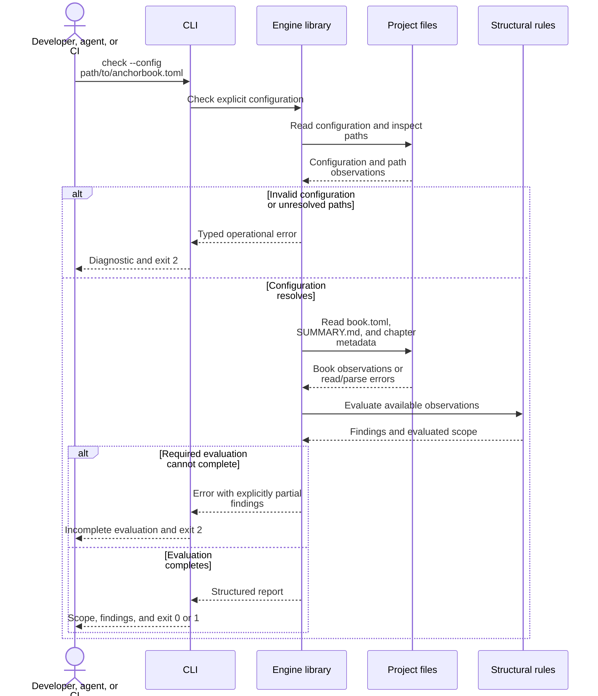

# Structural Checking

**Status: draft for review.** This is the selected first capability. The command
and library operation are not implemented.

`check` answers whether the current Book conforms to a declared set of rules.
The first increment covers configured layout and navigation. It supplies the
shared basis for later initialization, adoption, and materialization.

The user outcome is an agent that can iterate on a Book's structure until it
conforms: check, understand the findings, make appropriate changes within the
assigned scope, and recheck. Diagnostics must identify what is wrong, where it
is, and what is expected. In the first increment, the agent performs the edits;
the checker itself remains read-only.

## Invocation and flow

Proposed invocation:

```sh
anchorbook check --config path/to/anchorbook.toml
```

Require an explicit configuration path initially. This avoids silently selecting
a different Book when invoked from a nested directory.



The library performs no writes, dependency downloads, subprocess execution,
materialization, or project test runs. Reading configuration must not execute
configured preprocessors. Checking works without rendering the Book.

## Initial rules

| Rule | Expected condition |
| --- | --- |
| Source directory | The configured Book source exists and is a directory |
| Summary | `SUMMARY.md` exists and is a readable, supported navigation document |
| Renderer configuration | `book.toml` exists and its source/output settings agree with the resolved Anchor Book configuration |
| Chapter targets | Local chapter targets referenced by navigation exist as files within the source directory |
| Required roles | Design, Authority, and Implementation Roadmaps each map to a distinct top-level linked chapter |

Check all linked chapter targets, including unnumbered introductory chapters
and nested chapters. Part headings and separators do not satisfy mapped roles.
Draft entries without a target cannot satisfy a required role; other draft
entries are allowed under mdBook's supported summary grammar.

Use the supported [mdBook navigation semantics](https://rust-lang.github.io/mdBook/format/summary.html). Handle local destinations as
paths; classify external destinations without fetching them. An external
destination cannot satisfy a required local section role. Unknown constructs
that prevent reliable evaluation produce an unsupported-input error.
Validation of links inside chapter prose and of heading fragments is outside
this first scope.

The detailed syntax support and mdBook version must be documented with the
parser chosen for implementation. The checker must not silently interpret
unrecognized navigation as an empty, valid Book.

## Findings and incomplete checks

The [Checking Diagnostics](check-diagnostics.md) design specifies the report
fields, diagnostic codes, expected/found descriptions, repair guidance, and
concrete examples for failed, incomplete, and passing invocations.

Each finding carries a stable rule identifier, severity, relevant location,
explanation, and suggested next action when useful. Diagnostics should name the
configured path and role rather than prescribe a hard-coded `book/` layout.
Prefer project-relative locations in user-facing output.

A missing source, summary, chapter, or renderer configuration is a structural
violation. Report the root cause and identify dependent rules as blocked,
without cascading misleading missing-chapter reports. This is a completed
evaluation with a known structural failure, not a successful result.

Malformed configuration or navigation, denied filesystem access, and unsupported
input that prevents evaluation are operational errors. Preserve useful findings
already collected, but label them partial. An empty list of findings must never
turn an incomplete evaluation into a pass.

| CLI status | Meaning |
| --- | --- |
| `0` | Evaluation completed with no error findings in the declared scope |
| `1` | Evaluation completed and found structural violations |
| `2` | Invalid invocation/configuration or inability to complete evaluation |

Operational failure takes precedence if structural violations were also found.
The library returns typed data; only the CLI chooses exit status. Human-readable
completed reports go to stdout; incomplete reports and their partial findings
go together to stderr. A machine
output format can be added with its own documented schema.

A passing report states its limited scope. It does not establish that design
is complete, anchors have adequate authority, implementation exists, tests pass,
formal claims hold, or roadmap units are finished.

## Acceptance against this Book

The primary acceptance case is this repository's current Book, configured with
`source = "book"` and `output = "target/anchorbook"`. Add the real configuration
as soon as the reader is usable. Keep destructive test cases in disposable copies.

| Case | Expected result |
| --- | --- |
| Current Book | Pass the declared structural scope |
| Equivalent layout under `docs/` or `md/` | Same result, without special directory-name handling |
| Invocation from another working directory | Same configuration and Book selected by the explicit path |
| Missing chapter or required role | Specific structural finding and exit `1` |
| Missing source or summary | Root-cause finding, dependent checks blocked, exit `1` |
| mdBook settings disagree | Drift finding; neither file is repaired |
| Invalid schema, typo, malformed summary, or unreadable input | Useful operational error and exit `2` |
| Source/output overlap or escape, including symlink aliases | Configuration rejected |
| Separate output does not exist | No error merely for absence; no directory created |
| Both passing and failing runs | Project files and directory entries remain unchanged |
| Library and CLI on the same fixture | Equivalent findings and scope |
| Broken current Book | Engine still compiles and independent fixture tests run |
| Agent repairs a deliberately broken Book copy | Findings guide scoped edits; rechecking passes, and independent review confirms valid repairs and preservation of unrelated content |
| Diagnostic report | Codes, locations, expected/found conditions, help, evaluated scope, and blocked checks match the diagnostics design; all information is readable without color |

Tests must assert expected failures as well as successful self-use. Include
navigation cases and path-resolution cases independently of the actual Book.
No test should need a network connection or another project's private sources.

## Later rule scopes

Managed content drift, detailed authority structure, anchor relationships,
cross-Book authority, and evidence applicability will extend the common model.
Their findings must still identify what was evaluated. Running project verifiers
and aggregating their completed evidence remain separate responsibilities;
expanding `check` must not introduce a recursive dependency on its own test run.
