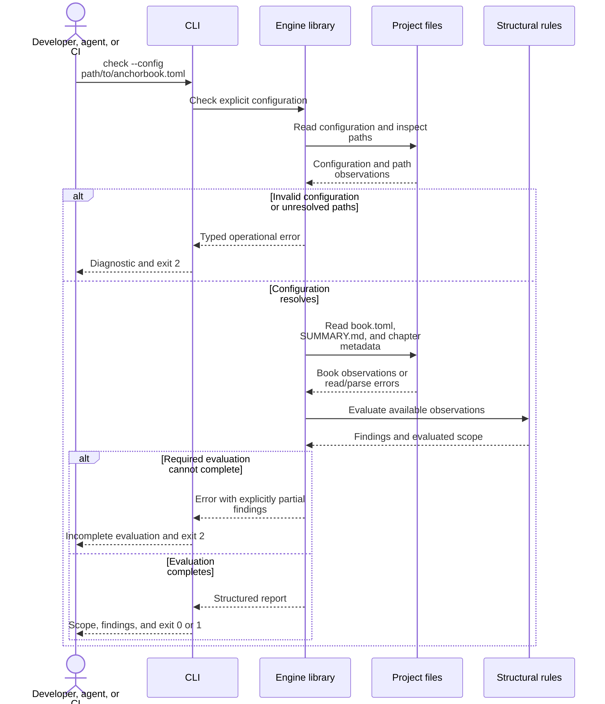

# Structural Checking

**Status: prototype implemented; verification in progress.** The library and
`anchorbook check` implement this layout/navigation scope. Local tests cover
passing, failing, and incomplete results; the roadmap records remaining evidence.

`check` answers whether the current Book conforms to its configured layout and
navigation rules. These rules will also support initialization, adoption of existing
projects, and materialization of managed content.

An agent uses the findings to locate defects, understand the expected structure,
make appropriate changes within its assignment, and recheck until the structure
passes. The agent performs those edits; the checker remains read-only.

## Anchors

```anchorbook-anchor
schema-version = 1
id = "check-observation-only"
title = "Checking preserves the Book for deliberate repair"
status = "draft"
property = '''
Engineers and agents can inspect a Book's format without changing the project
or triggering its tools. Passing, failing, and incomplete checks leave project
content and directory entries unchanged. Checking does not render, fetch
dependencies, or execute subprocesses, preprocessors, tests, or verifiers.
Repairs remain separate actions so the engineer or agent controls what changes.
'''
authorities = [
  { kind = "requirement", id = "requirement-observation-only" },
  { kind = "decision", id = "decision-separate-check-and-repair" },
]

[[criteria]]
id = "file-preservation"
verification = ["test"]
statement = "Compare project file contents and directory entries before and after passing, failing, and incomplete library and CLI checks, including missing source and output; they remain unchanged."

[[criteria]]
id = "no-execution"
verification = ["test"]
statement = "Use fixtures with configured execution traps and run with subprocess and network activity denied or observed; checking neither attempts those operations nor requires generated Book output."
```

```anchorbook-anchor
schema-version = 1
id = "check-navigation-conformance"
title = "Navigation findings guide repairs to the configured Book format"
status = "draft"
property = '''
The checker identifies where the Book's chapters and required sections differ
from its configured structure, and reports the location and expected structure
so an engineer or agent can correct the format and recheck. Navigation passes
only when the source, chapter targets, and required sections satisfy all defined
navigation rules. Unreadable, malformed, or unsupported navigation prevents a
pass and is reported as incomplete evaluation, not as an empty valid Book.
'''
authorities = [
  { kind = "requirement", id = "requirement-repair-feedback" },
  { kind = "requirement", id = "requirement-configured-structure" },
  { kind = "decision", id = "decision-mdbook-structure" },
]

[[criteria]]
id = "chapter-inventory"
verification = ["test"]
statement = "Use independently specified fixtures for missing source or SUMMARY.md and missing, non-file, or escaping chapter targets at numbered, unnumbered, and nested locations. Assert findings identify the affected location and expected structure, with dependent checks blocked when prerequisites are absent. Correct each seeded defect and recheck; valid navigation passes."

[[criteria]]
id = "required-roles"
verification = ["test"]
statement = "Exercise each required role as present, absent, nested, or replaced by a heading, separator, targetless draft, or external link. Only distinct configured top-level local chapters satisfy the roles. Assert failures identify the role, relevant declaration, and expected placement; restoring that structure makes the role check pass."

[[criteria]]
id = "grammar-boundary"
verification = ["test"]
statement = "Against the documented supported mdBook grammar and version, test valid numbered, unnumbered, and nested navigation, part headings, separators, and targetless drafts outside required roles. Classify external links without fetching them. Malformed, unreadable, or unsupported navigation produces a located incomplete result identifying the input problem and blocked checks, never an empty successful inventory."
```

```anchorbook-anchor
schema-version = 1
id = "check-renderer-alignment"
title = "The checked Book and rendered Book use the intended layout"
status = "draft"
property = '''
The checker detects when mdBook's file-based source or output settings differ
from the intended Anchor Book layout, so an engineer or agent can align them
before rendering. Findings identify the differing settings and expected locations
without changing either configuration. Equivalent resolved locations, including
mdBook defaults, agree even when spelled differently. This guarantee covers the
adjacent book.toml, not environment or command-line overrides.
'''
authorities = [
  { kind = "requirement", id = "requirement-repair-feedback" },
  { kind = "requirement", id = "requirement-configured-structure" },
  { kind = "decision", id = "decision-mdbook-structure" },
]

[[criteria]]
id = "resolved-comparison"
verification = ["test"]
statement = "Check matching, mismatching, defaulted, and equivalently spelled source/output paths against independent expected locations. Drift findings identify the relevant settings and expected locations; aligning those settings makes the check pass without the checker editing either file."

[[criteria]]
id = "renderer-input"
verification = ["test"]
statement = "A missing book.toml is a structural violation; malformed or unreadable renderer configuration prevents a pass. Verify neither configuration is changed."
```

## Invocation and flow

Invocation:

```sh
anchorbook check --config path/to/anchorbook.toml
```

Require an explicit configuration path initially. This avoids silently selecting
a different Book when invoked from a nested directory.



All stages preserve the [observation-only property](#check-observation-only).
Reading configuration must not execute configured preprocessors, and checking
works without rendered output. Repairs, materialization, and project test runs
are separate from this operation.

## Initial rules

| Rule | Expected condition |
| --- | --- |
| Source directory | The configured Book source exists and is a directory |
| Summary | `SUMMARY.md` exists and is a readable, supported navigation document |
| Renderer configuration | `book.toml` exists and its source/output settings agree with the resolved Anchor Book configuration |
| Chapter targets | Local chapter targets referenced by navigation exist as files within the source directory |
| Required roles | Design, Authority, and Implementation Roadmaps each map to a distinct top-level linked chapter |

Check all linked chapter targets, including unnumbered introductory chapters
and nested chapters. Part headings and separators do not satisfy mapped roles.
Draft entries without a target cannot satisfy a required role; other draft
entries are allowed under mdBook's supported summary grammar.

Use the supported [mdBook navigation semantics](https://rust-lang.github.io/mdBook/format/summary.html). Handle local destinations as
paths; classify external destinations without fetching them. An external
destination cannot satisfy a required local section role. Unknown constructs
that prevent reliable evaluation produce an unsupported-input error.
Validation of links inside chapter prose and of heading fragments is outside
this first scope.

Document the parser's supported syntax and mdBook version. Unrecognized
navigation cannot be interpreted as an empty, valid Book.

## Navigation parser

Use the standalone [`mdbook-summary` 0.5.4 parser](https://github.com/rust-lang/mdBook/blob/v0.5.4/crates/mdbook-summary/src/lib.rs)
for the chapter hierarchy. Call `parse_summary(&str)` with text already read by
the checking operation. Its output includes prefix, numbered, and suffix chapters,
nesting, targetless drafts, part titles, and separators. This does not load chapter
files, create missing files, render, or run preprocessors. Keep it behind a private
adapter that returns the engine's own observed-navigation model.

The implementation pins `mdbook-summary = "=0.5.4"` and `mdbook-core = "=0.5.4"`,
with tested transitive versions in Cargo.lock. The core crate also supplies pure
`book.toml` deserialization and mdBook defaults; environment overrides are not applied. The parser and its mdbook-core dependency
[require Rust 1.88](https://github.com/rust-lang/mdBook/blob/v0.5.4/Cargo.toml),
now the engine's minimum; development uses current stable. The dependency
chain adds core data/configuration support, including another TOML library, but
not mdBook's driver or HTML/server runtime. The parser is integrated through the private navigation adapter; its types do
not appear in the public checking API.

Parsing and conformance are separate. The parser can ignore prose, code blocks,
and unsupported headings, even returning an empty summary. Use pulldown-cmark
Markdown events and offsets to validate the supported summary syntax before a
successful structural result. Preserve ordinary chapter-label formatting, valid
comments, parts, separators, and targetless drafts. Non-navigation prose, code
blocks, and unsupported headings produce a located unsupported-input result;
malformed input that prevents evaluation is incomplete. Chapter lists use the
mdBook bullet forms (`-` or `*`); numeric Markdown lists are unsupported. Nesting
is bounded to 128 list levels before invoking the recursive summary parser;
deeper input yields incomplete evaluation. An otherwise supported
empty or title-only summary still fails the required-role rules. Do not treat
an ignored construct as evidence that an expected chapter or role does not exist.

Parsed links lack source spans. Retain source ranges from the Markdown event
stream and associate them with the observed entries, including reference-style
links. Do not scrape positions from the parser's human-readable error strings.
Where a reliable position is unavailable, identify the summary file and affected
target without inventing a line number. Preserve the underlying parser error as
a cause while exposing the engine's stable diagnostic vocabulary.

Destinations arrive as path values, even for external URLs. Classify external
links before filesystem inspection and never fetch them. Preserve the supported
parser's destination interpretation when mapping local targets; it decodes `%20`
and retains fragments in the path. Do not silently strip fragments or apply
additional URL decoding that changes which file mdBook would select. Filesystem
containment, existence, required-role placement, and renderer alignment remain
checker responsibilities.

Verification must cover the current Book and independent fixtures for hierarchy,
drafts, part titles, separators, reference links, external destinations, encoded
spaces, duplicate targets, malformed links, and input the parser silently ignores.
Check source locations and typed errors through the real checker API and CLI;
the parser feasibility experiment is not implementation evidence for those rules.

## Implemented boundaries

`anchor_book::checking::check(&Path)` returns a completed `CheckReport` or a
`CheckError` retaining a partial report. Check the report's `outcome()`; an `Ok`
report can contain structural violations. Inputs and observed targets are collected
by the private inspection module; rules evaluate those observations without
filesystem access. The navigation module validates supported input and maps
mdBook's hierarchy to source locations. Typed findings carry codes, kinds, severity,
locations, expected/found conditions, guidance, and underlying causes.

`adapters::check::format_report` returns plain text without process I/O. The CLI
chooses the stream and exit status. No logging subscriber, mdBook loader, project
tool, or network fetch is invoked. Control characters in displayed input are
escaped. Filesystem observations are a snapshot, not permission for later writes.

Role checks establish placement of configured local navigation entries; chapter
checks establish that their targets are files. Both must pass. Unresolvable target
identities block role conclusions that depend on them rather than inventing missing
roles. Independent findings remain available when another group cannot complete.

## Findings and incomplete checks

The [Checking Diagnostics](check-diagnostics.md) design specifies the report
fields, diagnostic codes, expected/found descriptions, repair guidance, and
concrete examples for failed, incomplete, and passing invocations.

Findings use configured paths and roles, with project-relative display locations,
rather than prescribing a hard-coded `book/` layout.

A missing source, summary, chapter, or renderer configuration is a structural
violation. Report the root cause and identify dependent rules as blocked,
without cascading misleading missing-chapter reports. This is a completed
evaluation with a known structural failure, not a successful result.

Malformed configuration or navigation, denied filesystem access, and unsupported
input that prevents evaluation are operational errors. Preserve useful findings
already collected, but label them partial. An empty list of findings must never
turn an incomplete evaluation into a pass.

| CLI status | Meaning |
| --- | --- |
| `0` | Evaluation completed with no error findings in the declared scope |
| `1` | Evaluation completed and found structural violations |
| `2` | Invalid invocation/configuration or inability to complete evaluation |

Operational failure takes precedence when structural violations were also found.
The library returns typed data; only the CLI maps it to an exit status. Completed
reports go to stdout. Incomplete reports, including any partial findings, go
together to stderr. A future machine-readable format needs its own documented schema.

A passing report states its limited scope. It does not establish that design
is complete, anchors have adequate authority, implementation exists, tests pass,
formal claims hold, or roadmap units are finished.

## Acceptance against this Book

The primary acceptance case is this repository's current Book, configured with
`source = "book"` and `output = "target/anchorbook"`. Add the real configuration
as soon as the reader is usable. Keep destructive test cases in disposable copies.

| Case | Expected result |
| --- | --- |
| Current Book | Pass the declared structural scope |
| Equivalent layout under `docs/` or `md/` | Same result, without special directory-name handling |
| Invocation from another working directory | Same configuration and Book selected by the explicit path |
| Missing chapter or required role | Specific structural finding and exit `1` |
| Missing source or summary | Root-cause finding, dependent checks blocked, exit `1` |
| mdBook settings disagree | Drift finding; neither file is repaired |
| Invalid schema, typo, malformed summary, or unreadable input | Useful operational error and exit `2` |
| Source/output overlap or escape, including symlink aliases | Configuration rejected |
| Separate output does not exist | No error merely for absence; no directory created |
| Both passing and failing runs | Project files and directory entries remain unchanged |
| Library and CLI on the same fixture | Equivalent findings and scope |
| Broken current Book | Engine still compiles and independent fixture tests run |
| Agent repairs a deliberately broken Book copy | Findings guide scoped edits; rechecking passes, and independent review confirms valid repairs and preservation of unrelated content |
| Diagnostic report | Codes, locations, expected/found conditions, help, evaluated scope, and blocked checks match the diagnostics design; all information is readable without color |

Tests must assert expected failures as well as successful self-use. Include
navigation cases and path-resolution cases independently of the actual Book.
No test should need a network connection or another project's private sources.

## Later rule scopes

Managed content drift, detailed authority structure, anchor relationships,
cross-Book authority, and evidence applicability will extend the common model.
Their findings must still identify what was evaluated. Running project verifiers
and aggregating their completed evidence remain separate responsibilities;
expanding `check` must not introduce a recursive dependency on its own test run.
