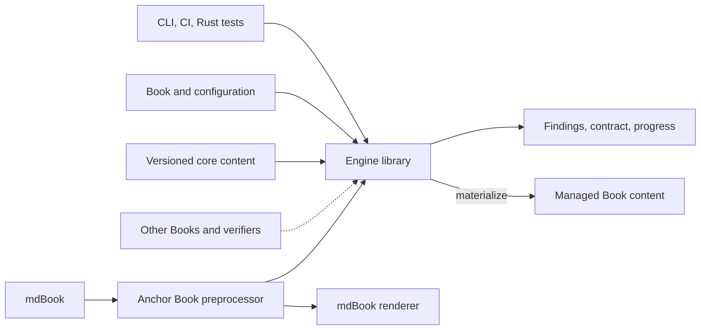
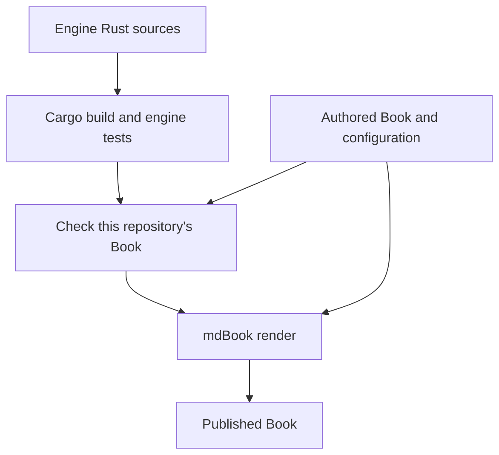

# System Overview


Anchor Book connects a project's intended design, its governing authority, the
work agreed for implementation, and evidence about the resulting system.
The engine maintains that structure and makes gaps and progress visible.
mdBook supplies the underlying Book structure and rendering.

## Anchor for developing the engine with this Book

```anchorbook-anchor
schema-version = 1
id = "check-independent-build"
title = "A broken Book remains diagnosable by its own engine"
status = "accepted"
property = '''
Engineers and agents can still build and use the checker to diagnose a broken
Book while developing Anchor Book with that Book. Engine compilation and
independent fixture tests do not require a valid or rendered repository Book.
Checking the current Book is a separate acceptance step before rendering, so
format defects can be reported without first repairing the Book to build its
checker.
'''
authorities = [
  { kind = "requirement", id = "requirement-independent-engine" },
]

[[criteria]]
id = "broken-book"
verification = ["test"]
statement = "In a disposable checkout with deliberately invalid Book navigation and no rendered output, compile the engine and run independent fixture tests successfully; the separate Book check reports the known failure."

[[criteria]]
id = "ci-order"
verification = ["review"]
statement = "Record actual CI results showing engine checks, current-Book acceptance, and then rendering for a valid revision; a broken Book fails acceptance without making engine compilation dependent on it."
```

## Components



The boxes describe responsibilities, not separate services or Cargo packages.
Dashed inputs are cross-Book and verifier
integrations whose formats are outside this design. People and agents use the CLI; automation can call
either the CLI or Rust library. On the rendering path, mdBook reads the authored
and managed Book files and supplies their chapter content to the preprocessor.

The [record-rendering adapter](record-rendering.md) uses shared records to present anchors and authorities within files read by mdBook. Structural
checking operates independently of the renderer and its output.

## What a Book describes

| Concept | Responsibility |
| --- | --- |
| Design | The intended system as a whole, as well as it is currently understood |
| Authority | Requirements and decisions that govern the system |
| Anchors | Named properties grounded in at least one authority, with criteria for verification |
| Implementation Roadmaps | AI-proposed work reviewed and agreed with people, including dependencies and completion evidence |
| Evidence and progress | What has been built, which verification mechanisms exist, what they establish, and which agreed work is complete |

A design change updates the goal; it does not establish that the change is
implemented. A roadmap defines agreed implementation work; evidence establishes
its completion.

A Book can provide authorities for another Book to consume. Consumers need an
explicit identity and revision for those authorities so changes can be reviewed.
Dependency identity, distribution, and conflict handling need further design.

Systems can provide test surfaces describing tests and their anchor associations.
An association is a claim about what a test addresses; it does not show that the
test ran or that its assertions are sufficient. Evidence must preserve execution
scope, relevant inputs, and outcomes. The model must also accommodate formal
verification, including statements, assumptions, bounds, and inconclusive results.

[Verification](verification.md) defines how tests, proofs, and reviews
establish criteria, including the guards that check a proof establishes its
criterion. The engine's own [authority proof](rust-engine.md#authority-proof) is
an example.

## Operations

Operations share engine models and rules. Record rendering obtains its chapter
inventory from mdBook and does not require project configuration.

| Operation | Purpose | Writes |
| --- | --- | --- |
| Initialize | Configure a new Book and establish its initial structure through materialization | Configuration and scaffold |
| Adopt | Map an existing project into Book roles, expose gaps, and apply reviewed changes through materialization | Agreed configuration and managed structure |
| Materialize | Reconcile required structure, core content, and selected integration settings | Declared managed content |
| Check | Evaluate the current Book against an explicit rule scope | None |
| Verify | Run the tests and proofs linked to anchor criteria and report progress by chapter, anchor, and criterion | Runner output only |
| Contract | Return the effective AI Working Contract through a command into agent context | None |
| Build | Assemble anchor, verification, and roadmap progress and render it using mdBook | Derived reports and rendered output |

Materialization preserves project-authored design and authority. It plans changes
within explicit ownership boundaries, detects conflicts, and produces no changes
when managed content already conforms. It does not prevent subsequent edits;
checks detect drift and CI can gate it.

Build keeps three views distinct: anchor development, verification evidence,
and agreed roadmap completion. Missing, failed, stale, or incomplete evidence
cannot count as successful verification. [Running Verification](verification-evidence.md)
defines the verify operation that evaluates evidence; Build presents its results.

## Contract delivery

The engine owns and versions the reusable AI Working Contract. Project-specific
state, paths, commands, and policies remain in normal Book content and configuration.
Repository bootstrap instructions identify the contract, project guidance, and
Book source. Agents read all three; retrieving the contract alone does not supply
project context.

The contract includes Rust guidance. Extensions for other languages are outside
this design.

`anchorbook contract` prints the contract packaged with the running engine. It
reads no project files, so its output is the same for every project using that
engine version. The engine keeps one contract source, maintained as section files
joined at compile time, without project-specific content or checked-in generated
copies; the Book refers to its sections by name. An agent integration must
retrieve and read the contract; packaging it alone does not place it in the
agent's working context. This repository's own startup and source location are in
[Working on Anchor Book](../working-on-anchor-book.md#contract-source).

## Tooling boundaries

The [Rust library](rust-engine.md) owns the shared behavior. Its CLI supports
ordinary local commands and GitHub Actions. Rust projects can call the same
library from integration tests. Neither Git nor GitHub is required to evaluate
a local Book. [Project Integration](project-integration.md) defines how other
Rust projects adopt the crate, run the engine, bootstrap agents, and verify
their own code.

The [mdBook preprocessor](https://rust-lang.github.io/mdBook/for_developers/preprocessors.html)
calls shared engine logic on mdBook's input. It runs the read-only structural
check first and renders nothing if that check fails or is incomplete, so ordinary
`mdbook build` and `mdbook serve` apply it without a wrapper command; see the
[native tool integration decision](../authority/decisions.md#decision-native-tool-integration).
It does not repair files, run tests, or recursively build the Book. Diagram preprocessors run alongside it.
[Record Rendering](record-rendering.md) defines the shared-model integration.

## Developing the engine with this Book



The diagram shows the CI order:
compile and test the engine, check this repository's Book, then render and publish
it. Engine compilation and independent fixture tests must not require a valid
or rendered Book. Current-Book acceptance is a separate step, so the engine remains
usable to diagnose and repair its own Book when that Book is broken.

The Book workflow calls the reusable Engine workflow from the same revision and
makes its build job depend on successful engine checks and current-Book acceptance.
The Anchor Book preprocessor runs the structural checker before rendering, so
every `mdbook build` refuses a structurally invalid Book; rendered-output
acceptance precedes publication.

Project verification runs independently and supplies completed evidence
to Book build. A structural integration test may run inside a project test suite;
it must not depend on the final results of the suite that contains it.

[Structural checking](structural-checking.md) supplies conformance rules for
initialization and materialization. This Book is the primary acceptance case,
supplemented by independent fixtures and deliberately broken copies.
