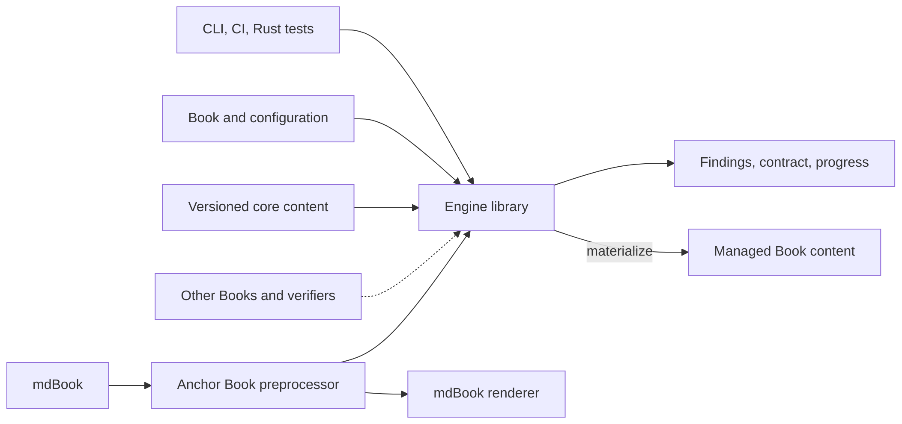
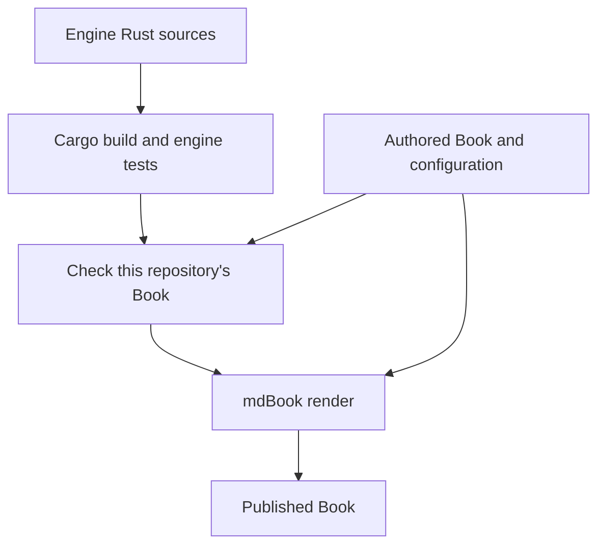

# System Overview

**Status: draft for review.** This describes the intended system. The repository
currently has a shared Rust record library and an mdBook adapter that renders
anchors and authorities. Other engine operations remain to be implemented.

Anchor Book connects a project's intended design, its governing authority, the
work agreed for implementation, and evidence about the resulting system.
The engine maintains that structure and makes gaps and progress visible.
mdBook supplies the underlying Book structure and rendering.

## Anchor for developing the engine with this Book

```anchorbook-anchor
schema-version = 1
id = "check-independent-build"
title = "A broken Book does not prevent building its checker"
status = "draft"
property = '''
Engine compilation and independent fixture tests do not require a valid or
rendered repository Book. Checking the current Book is a separate acceptance
step before rendering, so the engine remains usable to diagnose a broken Book.
'''
authorities = [
  { kind = "requirement", id = "requirement-independent-engine" },
]

[[criteria]]
id = "broken-book"
statement = "In a disposable checkout with deliberately invalid Book navigation and no rendered output, compile the engine and run independent fixture tests successfully; the separate Book check reports the known failure."

[[criteria]]
id = "ci-order"
statement = "Record actual CI results showing engine checks, current-Book acceptance, and then rendering for a valid revision; a broken Book fails acceptance without making engine compilation dependent on it."
```

## Components



The boxes describe responsibilities, not separate services or Cargo packages.
Dashed inputs identify later cross-Book and verification integrations whose
formats still need design. People and agents use the CLI; automation can call
either the CLI or Rust library. On the rendering path, mdBook reads the authored
and managed Book files and supplies their chapter content to the preprocessor.

The [record-rendering adapter](record-rendering.md) is implemented. It uses shared
records to present anchors and authorities within files read by mdBook. Structural
checking is planned and will not depend on the renderer or its output.

## What a Book describes

| Concept | Responsibility |
| --- | --- |
| Design | The intended system as a whole, as well as it is currently understood |
| Authority | Requirements and design decisions that govern the system |
| Anchors | Named properties grounded in at least one authority, with criteria for verification |
| Design Proposals | Changes under discussion, identifying affected design, authorities, and anchors, including proposed additions |
| Implementation Roadmaps | AI-proposed work reviewed and agreed with people, including dependencies and completion evidence |
| Evidence and progress | What has been built, which verification mechanisms exist, what they establish, and which agreed work is complete |

An approved proposal must be reconciled with the affected design and authority.
Approval does not establish that its implementation is complete. A roadmap
defines agreed implementation work; evidence establishes its completion.

A Book can provide authorities for another Book to consume. Consumers need an
explicit identity and revision for those authorities so changes can be reviewed.
Dependency identity, distribution, and conflict handling need further design.

Systems can provide test surfaces describing tests and their anchor associations.
An association is a claim about what a test addresses; it does not show that the
test ran or that its assertions are sufficient. Evidence must preserve execution
scope, relevant inputs, and outcomes. The model must also accommodate formal
verification, including statements, assumptions, bounds, and inconclusive results.

## Operations

Operations share engine models and rules. The first rendering prototype obtains
its chapter inventory from mdBook; it does not yet require the planned project
configuration reader.

| Operation | Purpose | Writes |
| --- | --- | --- |
| Initialize | Configure a new Book and establish its initial structure through materialization | Configuration and scaffold |
| Adopt | Map an existing project into Book roles, expose gaps, and apply reviewed changes through materialization | Agreed configuration and managed structure |
| Materialize | Reconcile required structure, core content, and selected integration settings | Declared managed content |
| Check | Evaluate the current Book against an explicit rule scope | None |
| Contract | Return the effective AI Working Contract through a command into agent context | None |
| Build | Assemble anchor, verification, and roadmap progress and render it using mdBook | Derived reports and rendered output |

Materialization preserves project-authored design and authority. It plans changes
within explicit ownership boundaries, detects conflicts, and produces no changes
when managed content already conforms. It does not prevent subsequent edits;
checks detect drift and CI can gate it.

Build keeps three views distinct: anchor development, verification evidence,
and agreed roadmap completion. Missing, failed, stale, or incomplete evidence
cannot count as successful verification. Concrete evidence adapters follow the
initial structural checker.

## Contract delivery

The engine owns and versions the reusable AI Working Contract. Project-specific
state, paths, commands, and policies remain in normal Book content and configuration.
Repository bootstrap instructions identify the contract, project guidance, and
Book source. Agents read all three; retrieving the contract alone does not supply
project context.

The contract currently includes Rust guidance. Language-specific instruction
extensions may be designed later; there is no extension mechanism yet.

During bootstrap, the [contract source](../ai-working-contract.md) is maintained
in this Book, with local context in [Working on Anchor Book](../working-on-anchor-book.md).
Once command delivery works, move the maintained source into the engine and update
agent startup to retrieve it. Remove the temporary Book copy and its navigation
entry in the same transition. Maintain one contract source, without injecting
project-specific content into it or checking in generated contract artifacts.
An agent integration must retrieve and read the contract; generation alone does
not place it in the agent's working context.

## Tooling boundaries

The [Rust library](rust-engine.md) owns the shared behavior. Its CLI supports
ordinary local commands and GitHub Actions. Rust projects can call the same
library from integration tests. Neither Git nor GitHub is required to evaluate
a local Book.

The [mdBook preprocessor](https://rust-lang.github.io/mdBook/for_developers/preprocessors.html)
calls shared engine logic on mdBook's input. It does not repair files, run tests,
or recursively build the Book. Diagram preprocessors run alongside it.
[Record Rendering](record-rendering.md) defines the shared-model integration;
indexes, evidence pages, and progress reporting follow later.

## Developing the engine with this Book



The diagram shows the intended CI order once structural checking is available:
compile and test the engine, check this repository's Book, then render and publish
it. Engine compilation and independent fixture tests must not require a valid
or rendered Book. Current-Book acceptance is a separate step, so the engine remains
usable to diagnose and repair its own Book when that Book is broken.

The rendering prototype has no placeholder structural-check step. Its remaining
[CI integration work](../implementation-roadmaps/record-rendering.md#record-rendering-3)
will make rendering and publication depend on engine checks and record acceptance
for the same revision.

Later, project verification runs independently and supplies completed evidence
to Book build. A structural integration test may run inside a project test suite;
it must not depend on the final results of the suite that contains it.

[Structural checking](structural-checking.md) follows rendering and supplies
conformance rules for initialization and materialization. This Book is the primary
acceptance case, supplemented by independent fixtures and deliberately broken copies.
Managed content, contract delivery, and evidence behavior follow later.
