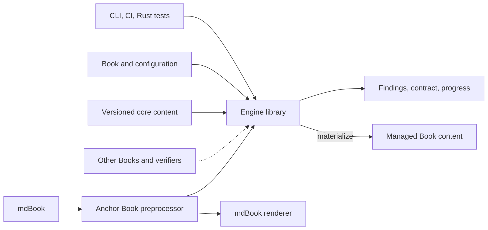
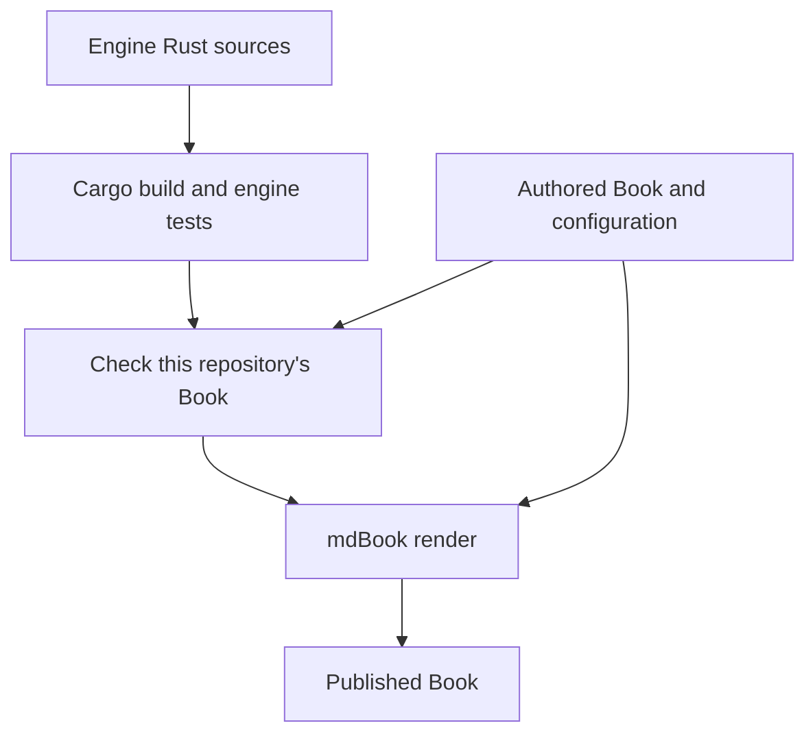

# System Overview

**Status: draft for review.** This describes the intended system. The repository
currently has a rendered Book; the engine is not implemented.

Anchor Book connects a project's intended design, its governing authority, the
work agreed for implementation, and evidence about the resulting system.
The engine maintains that structure and makes gaps and progress visible.
mdBook supplies the underlying Book structure and rendering.

## Components



The boxes describe responsibilities, not separate services or Cargo packages.
All engine components are planned. Dashed inputs identify later cross-Book and
verification integrations whose formats still need design. The preprocessor is
a later adapter for rendering anchor markup and derived views; the first checker
does not require it.

People and agents use the CLI; automation can use either the CLI or the library.
The rendering path reads authored and managed Book files through mdBook.

## What a Book describes

| Concept | Responsibility |
| --- | --- |
| Design | The intended system as a whole, as well as it is currently understood |
| Authority | Requirements and design decisions that govern the system |
| Anchors | Named properties grounded in at least one authority, with criteria for verification |
| Design Proposals | Changes under discussion, identifying affected design, authorities, and anchors, including proposed additions |
| Implementation Roadmaps | AI-proposed work reviewed and agreed with people, including dependencies and completion evidence |
| Evidence and progress | What has been built, which verification mechanisms exist, what they establish, and which agreed work is complete |

An approved proposal must be reconciled with the affected design and authority.
Approval does not establish that its implementation is complete. A roadmap
defines agreed implementation work; evidence establishes its completion.

A Book can provide authorities for another Book to consume. Consumers need an
explicit identity and revision for those authorities so changes can be reviewed.
Dependency identity, distribution, and conflict handling need further design.

Systems can provide test surfaces describing tests and their anchor associations.
An association is a claim about what a test addresses; it does not show that the
test ran or that its assertions are sufficient. Evidence must preserve execution
scope, relevant inputs, and outcomes. The model must also accommodate formal
verification, including statements, assumptions, bounds, and inconclusive results.

## Operations

All operations share the configuration and rule model.

| Operation | Purpose | Writes |
| --- | --- | --- |
| Initialize | Configure a new Book and establish its initial structure through materialization | Configuration and scaffold |
| Adopt | Map an existing project into Book roles, expose gaps, and apply reviewed changes through materialization | Agreed configuration and managed structure |
| Materialize | Reconcile required structure, core content, and selected integration settings | Declared managed content |
| Check | Evaluate the current Book against an explicit rule scope | None |
| Contract | Return the effective AI Working Contract through a command into agent context | None |
| Build | Assemble anchor, verification, and roadmap progress and render it using mdBook | Derived reports and rendered output |

Materialization preserves project-authored design and authority. It plans changes
within explicit ownership boundaries, detects conflicts, and produces no changes
when managed content already conforms. It does not prevent subsequent edits;
checks detect drift and CI can gate it.

The AI Working Contract is engine-owned guidance specialized by the Book's
configuration. Its source content is versioned with the engine. Its generated
text will be returned on demand, without a checked-in generated artifact or a
permanent Book chapter. During bootstrap, the manually maintained
[AI Working Contract](../ai-working-contract.md) supplies that guidance; it will
move into the engine when command-based delivery works.
An agent integration must retrieve and read it; generation alone does not put
it into an agent's working context.

Build keeps three views distinct: anchor development, verification evidence,
and agreed roadmap completion. Missing, failed, stale, or incomplete evidence
cannot count as successful verification. Concrete evidence adapters follow the
initial structural checker.

## Tooling boundaries

The [Rust library](rust-engine.md) owns the shared behavior. Its CLI supports
ordinary local commands and GitHub Actions. Rust projects can call the same
library from integration tests. Neither Git nor GitHub is required to evaluate
a local Book.

The later [mdBook preprocessor](https://rust-lang.github.io/mdBook/for_developers/preprocessors.html)
handles render-time integration. It consumes the
Book passed by mdBook and calls shared engine logic. It does not repair source
files, run project tests, or recursively invoke a Book build. Diagram
preprocessors remain presentation integrations alongside it.

## Developing the engine with this Book



This is the intended CI dependency order. Compiling the engine must not require
a valid or rendered Book. Independent engine tests use fixtures; a separate
acceptance check exercises the current Book. A broken Book can therefore be
diagnosed and repaired with the engine.

Later, project verification runs independently and supplies completed evidence
to Book build. A structural integration test may run inside a project test suite;
it must not depend on the final results of the suite that contains it.

[Structural checking](structural-checking.md) comes first because initialization
and materialization need a shared definition of conformance. The actual Book in
this repository is the first acceptance case, supplemented by deliberately
broken copies and other layouts. Subsequent increments add managed content,
contract delivery, and anchor and evidence behavior.

## Anchor for developing the engine with this Book

This draft uses the [structured anchor format](anchor-definitions.md).
Implementation and verification evidence are pending.

<a id="check-independent-build"></a>

```anchorbook-anchor
schema-version = 1
id = "check-independent-build"
title = "A broken Book does not prevent building its checker"
status = "draft"
property = '''
Engine compilation and independent fixture tests do not require a valid or
rendered repository Book. Checking the current Book is a separate acceptance
step before rendering, so the engine remains usable to diagnose a broken Book.
'''
authorities = [
  { kind = "requirement", id = "requirement-independent-engine" },
  { kind = "decision", id = "decision-independent-book-acceptance" },
]

[[criteria]]
id = "broken-book"
statement = "In a disposable checkout with deliberately invalid Book navigation and no rendered output, compile the engine and run independent fixture tests successfully; the separate Book check reports the known failure."

[[criteria]]
id = "ci-order"
statement = "Record actual CI results showing engine checks, current-Book acceptance, and then rendering for a valid revision; a broken Book fails acceptance without making engine compilation dependent on it."
```
