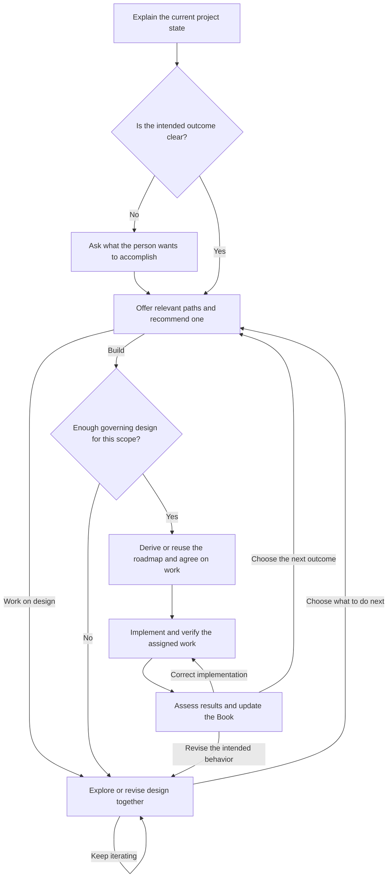

# Using Anchor Book with an agent

Start with what you want to accomplish. You do not need to know the Book's record
syntax, choose a phase, or name a milestone before asking for help. For example:

> I'm new to Anchor Book. Explain how we should use it in this project and
> recommend the next step.

The agent reads your project's guidance and Book, checks its structure, and
briefly explains where the project stands. If your intended outcome is not yet
clear, that is a useful point to ask what you want to accomplish; it can suggest
examples when you are unsure. It then offers relevant paths from the current
state and recommends one with a reason. You can ask for the full readiness report
when you want the complete inventory of work and evidence.

This chapter defines the conversational user flow, grounded in
[R-guided-workflow](../authority/requirements.md#R-guided-workflow). The engine
supplies the reusable guidance through its working contract; your project's Book
supplies the actual design, decisions, work, commands, and results.

## Move between design and building

You can work on design or iterate on building at any point. Building has a
dependency: enough governing design must exist for the scope being planned and
implemented. Designing a capability does not commit you to build it next. A
finding during implementation can lead back to design, while an implementation
defect can be corrected against the existing design.

The dependency is scoped to the capability being built, not to completion of the
whole Book. Its design explains behavior, responsibilities, interfaces, and
failure cases. Its key correctness guarantees have anchors grounded in
requirements or decisions, with criteria that state how they will be verified.
These definitions supply the basis for implementation milestones:

```mermaid
%%{init: {"flowchart": {"curve": "basis", "padding": 18, "useMaxWidth": false}, "themeVariables": {"fontFamily": "system-ui, -apple-system, BlinkMacSystemFont, Segoe UI, sans-serif", "fontSize": "16px"}}}%%
flowchart LR
    authority["Requirements and decisions"] -->|"Ground"| anchors["Anchors and verification criteria"]
    anchors -->|"Define key guarantees within"| design["Coherent design for the capability"]
    design -->|"Supports"| roadmap["Implementation roadmap"]
    roadmap -->|"Defines agreed scope"| build["Building and verification"]
    class authority guide-context
    class anchors,design guide-design
    class roadmap,build guide-build
```

This diagram shows dependencies, not an authoring order. Design discussions can
reveal requirements, choices, or missing anchors, and all can evolve together.
Requirements state required outcomes; decisions record choices; anchors cite the
applicable authority. Routine testable details need no anchor. Research and design
milestones may help establish missing knowledge, and assigned prototypes may use
draft designs under the project's phase rules.

A single conversation can move between these activities. If you have already
agreed on the design and assigned work, the agent proceeds without repeating the
same approvals. A question about the process does not reset that assignment.

| At this point | What you can ask | What the agent should make available |
| --- | --- | --- |
| Understand the project | “Where are we, and what should we do next?” | A short account of the current goal, relevant work and evidence, the next useful step, and anything it needs from you. |
| Work out the design | “Help me design cancellation for background work. Explain the choices and failure cases.” | A coherent design with responsibilities, workflows, tradeoffs, and key correctness guarantees for your judgment. |
| Review choices | “Walk me through the decisions I need to make and recommend an option for each.” | Consequences and recommendations, distinguishing previously agreed choices from unresolved ones. |
| Agree on work | “Propose the next milestone from this design.” | A bounded outcome, dependencies, tasks, and observable completion criteria. Missing design is identified before implementation planning. |
| Assign implementation | “Implement milestone [identifier] using the agreed design.” | Changes and relevant tests within that assignment, with progress and evidence recorded in the Book. Actual unmet prerequisites are explained. |
| Assess the result | “What works now, what is verified, and what remains uncertain?” | Separate accounts of implemented behavior, executed checks, uncovered criteria, and remaining work, with supporting references. |
| Change direction | “We now need offline operation. Show the effect on the design and existing work.” | A proposed design change, affected guarantees and evidence, and reconciled work. Use an RFD if this project enables that process. |
| Resume | “Continue the assigned work and tell me if anything material has changed.” | The existing assignment and agreements carried forward, with current progress and any new obstacle. Clarification only if the intended assignment cannot be recovered. |

An anchor names a key guarantee that makes the system correct, such as preserving
user data or accepting results only after valid completion. The agent explains
why each proposed anchor matters. Routine testable details can stay in design
and tests. You judge the intended guarantee; executable tests or proofs establish
its verification state. You do not need to supply anchor syntax yourself.

## Choose the starting point that fits

**A new project.** Describe the problem, intended users, and a first useful
capability. Ask: “Help me establish an Anchor Book for this project and design the
first useful capability.” The agent checks available setup support, proposes the
Book's scope, and asks about consequential unknowns. If initialization is not
implemented by the selected engine, it explains the supported manual setup.
A large implementation roadmap is not the first deliverable.

**An existing repository.** Ask: “Help me understand and document this system from
its code, tests, and existing decisions.” The agent reconstructs its purpose and
behavior, distinguishes observed implementation from intended guarantees, and
raises discrepancies for your judgment. Existing user documentation can remain a
separate Book. Documenting current behavior does not authorize changing the system.

**A port.** Name the source, target, and reason for the move when you know them.
Ask: “Help me port [source] to [target]. Start with the compatibility choices and
a design for [capability].” The agent asks only for missing intent and constraints,
uses source behavior as research, and writes the target design before proposing
implementation milestones. You choose the compatibility and completion boundaries;
source code does not automatically define the target's requirements.

**An existing Book.** Ask for orientation or name the capability you want to work
on. If design is missing, ask: “Find the important design choices that are only in
roadmaps and propose their proper homes.” The agent preserves accepted decisions,
work identities, and evidence while surfacing missing design and unresolved choices.
There is no need to restart the project to repair its Book.

The phase adjusts the loop. Prototyping permits assigned experiments with draft
designs; Building requires accepted governing design for implementation; Port adds
source research and explicit compatibility choices. Complete records a finished
scope and its evidence. You direct phase changes. Creating documentation is a
kind of work, not a separate phase, and a completed milestone need not end a phase.

## Get useful guidance in the conversation

The agent answers the question you asked first. When you need direction, it
starts with the relevant current state. It uses the outcome you have already
expressed, or asks what you want to accomplish if that remains unclear. It then
presents a few useful paths from that state and recommends one with a reason.
Each path explains what it accomplishes, any input needed from you, and a prompt
you can use or adapt. Links to the owning design or milestone let you inspect the
recommendation. A specific request goes directly to that work, with only choices
or gaps that affect it surfaced; the agent need not repeat the menu.

For example, if a Book has proposed implementation milestones but no design for
the capability, a useful response is:

> The roadmap lists implementation tasks, but it does not yet explain how a
> running operation is cancelled or who releases its resources. I recommend
> settling that lifecycle design first. The main choice is whether cancellation
> waits for cleanup or returns immediately with cleanup still in progress.
> You could ask: “Draft the cancellation lifecycle, explain both choices, and
> recommend one before revising the milestone.”

If the design is agreed and an assigned milestone is already in progress, the
agent instead continues that assignment. A question about the process does not
cancel the work or require another approval. A prompt example is explanatory
text until you use it; asking for guidance alone starts no new implementation.

You can also ask targeted questions without entering the whole loop:

- “Explain this anchor and why its guarantee matters.”
- “Why is this milestone not ready, and what would make it ready?”
- “Show which criteria have executable evidence and which are still uncovered.”
- “The tests pass. What does that establish, and what does it leave unverified?”
- “Give me the full readiness report.”
- “Prepare this change for a pull request using our contribution workflow.”

Use ordinary language; these are examples, not commands or required spellings.
The agent turns an assigned task into the project's actual engine and development
commands. A structural check establishes Book conformance. Verification reports
current evidence within its evaluated scope. Review, implementation progress,
anchor satisfaction, and publishing remain distinct facts.

## Anchor walkthroughs

You can ask the agent to walk through the design's anchors before implementation,
explaining each guarantee, its authority, and the planned verification. Whether
the agent should proactively offer this optional walkthrough when proposing
implementation work remains an open interaction choice for the guide. It is
separate from required design acceptance and from programmatic verification.

## Delivery through the engine

The common contract's “Guide the user through the workflow” section supplies the
conversation behavior and compact prompt examples. It is delivered by the existing
`anchorbook contract` and configured retrieval in every phase. The agent combines
it with the current project's Book; the engine does not infer project state or
choose work when printing the contract. The section is self-contained and needs
no network fetch or access to the engine's own Book during a consuming session.

This chapter owns the user-flow design and the fuller guide. Contract source owns
the instructions actually delivered to agents. Changes reconcile both in one diff;
projects maintain neither a copied guide nor a forked contract. The design links
from the introduction, while the contract links internally to the applicable
collaboration, phase, roadmap, and verification guidance.

A guidance request gets a concise conversational answer. General explanation
needs no project-readiness report. Project-specific recommendations still require
reading and checking the current Book; unavailable context is named rather than
invented. An explicit request for a readiness report, or to read the Book, uses
the existing full report. Presentation changes do not waive the prerequisites
for assigned implementation.

Only capabilities supported by the selected engine and project are offered as
available actions. The guide cannot make planned initialization, RFD automation,
or an unsupported verification runner available. Bootstrap still owns retrieval;
if it fails, the agent reports that failure and the supported recovery path.
There is no new CLI subcommand, configuration role, or prompt parser in this design.

[Project Integration milestone 6](../implementation-roadmaps/project-integration.md#project-integration-6)
owns delivery and conversational trials. Existing contract-retrieval guarantees
cover packaging; helpfulness and teaching quality need observation in real
sessions, not an anchor for each suggested prompt.
