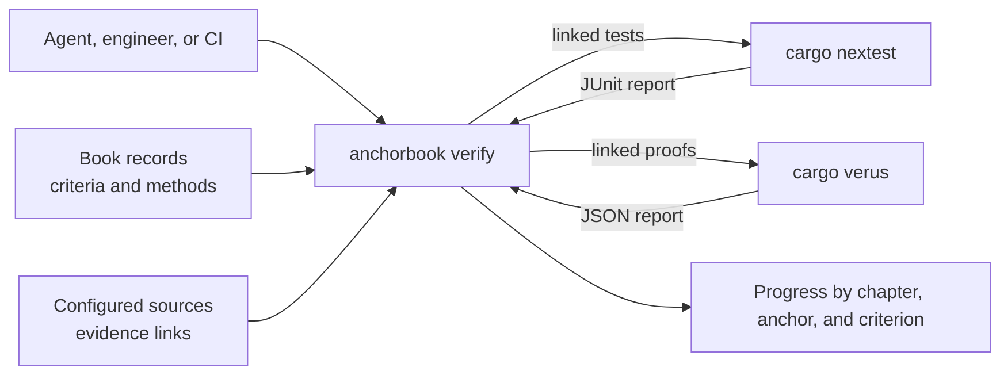

# Verification Evidence

**Status: draft for review.** Not implemented; the
[Verification Evidence roadmap](../implementation-roadmaps/verification-evidence.md)
plans the work.

`anchorbook verify` reports the project's progress toward its goal design: for
each anchor and each criterion's required methods, what current tests and proofs
establish. It finds the tests and proofs linked to the criteria in scope, runs
exactly those through the project's own tools, and reports each criterion's state
by design chapter and anchor.

It is a status tool, not a gate. A Book describes a system that is still being
built, so unlinked or unsatisfied criteria are progress to report, not errors.
The same command serves an agent in the build loop, checking the anchor it is
working on after each change, and CI, reporting the whole Book. It complements
`check`, which evaluates Book structure only.

## Anchors

```anchorbook-anchor
schema-version = 1
id = "verify-criterion-states"
title = "Every criterion has an honest evidence state"
status = "draft"
property = '''
For every anchor criterion in the evaluated scope, and each verification method
it requires, verify reports exactly one state from a closed set. A criterion is
satisfied only when every required method has passing evidence from the current
run. Failed, inconclusive, missing, unlinked, or unevaluated evidence never counts
as satisfied, and a satisfied criterion is reported as linked tests or proofs
passing, not as proof that they are sufficient.
'''
authorities = [
  { kind = "requirement", id = "requirement-criterion-evidence" },
]

[[criteria]]
id = "state-per-method"
verification = ["test"]
statement = "Independent fixtures produce each state for test and proof methods, including criteria requiring several methods with only some satisfied; assert the per-method and per-criterion states and that only fully satisfied criteria are satisfied."

[[criteria]]
id = "scope-and-limits"
verification = ["test"]
statement = "A run scoped to fewer methods or anchors reports the excluded parts as not evaluated, never as satisfied, and every report states what a satisfied criterion does not establish."
```

```anchorbook-anchor
schema-version = 1
id = "verify-progress-report"
title = "Verify reports progress, not failure, for a Book in progress"
status = "draft"
property = '''
A completed verify run reports every anchor in scope, grouped by design chapter,
with each criterion's state and its linked tests or proofs, and summary counts of
satisfied, partial, failing, and unlinked anchors and criteria. Unsatisfied and
unlinked criteria are reported as progress and do not make the run fail; the run
fails only when it cannot evaluate the scope, such as invalid configuration, an
invalid Book, or invalid records.
'''
authorities = [
  { kind = "requirement", id = "requirement-criterion-evidence" },
]

[[criteria]]
id = "progress-output"
verification = ["test"]
statement = "For a fixture Book with satisfied, partial, failing, and unlinked anchors, the library and actual CLI report every anchor under its chapter with the expected states, links, and summary counts, and the CLI exits 0."

[[criteria]]
id = "incomplete-runs"
verification = ["test"]
statement = "Invalid configuration, structure, or records make the run incomplete with a located diagnostic and a nonzero exit; a runner that cannot build or start makes only its method inconclusive."
```

```anchorbook-anchor
schema-version = 1
id = "verify-links-resolve"
title = "Links between code and criteria cannot drift silently"
status = "draft"
property = '''
Every evidence link in the configured sources names an existing anchor criterion
that requires the link's method, and every criterion requiring a linkable method
has at least one link or is reported as unlinked. A link naming an unknown anchor
or criterion, or a criterion that does not require its method, is reported at the
link's source location.
'''
authorities = [
  { kind = "requirement", id = "requirement-criterion-evidence" },
  { kind = "decision", id = "decision-evidence-links-in-code" },
]

[[criteria]]
id = "link-findings"
verification = ["test"]
statement = "Fixtures with dangling anchor and criterion links, method mismatches, misplaced and duplicate links, and unlinked criteria each produce the expected located finding; correcting them removes it."
```

```anchorbook-anchor
schema-version = 1
id = "verify-runs-linked-checks"
title = "Verify runs exactly the linked checks and changes no sources"
status = "draft"
property = '''
Verify runs only the configured runners, selecting the tests and proofs linked
to the criteria in scope, and reads only the results of that run, so its states
describe the files as they are now. A linked test that the run did not execute,
or reported as skipped or missing, has no evidence. Verify changes no Book or
source files; runner output is written only under the configured output directory.
'''
authorities = [
  { kind = "decision", id = "decision-verify-runs-linked-checks" },
]

[[criteria]]
id = "selected-run"
verification = ["test"]
statement = "With fixture runners that record their invocation, a scoped run invokes only the configured runners with exactly the linked tests in scope, and reports from earlier runs are never read."

[[criteria]]
id = "source-preservation"
verification = ["test"]
statement = "Compare Book and source file contents and directory entries before and after passing, failing, and incomplete runs; they are unchanged, and runner output appears only under the output directory."
```

## Flow



In the build loop, an agent runs `anchorbook verify --anchor <id>` after a change
to see that anchor's criteria against the current files. CI runs it for the whole
Book and keeps the printed report.

## Evidence links

A link is a comment line in source code naming one anchor criterion:

```rust
// anchorbook: check-observation-only#file-preservation
#[test]
fn checks_preserve_files_and_directory_entries() { /* ... */ }
```

The line `// anchorbook: <anchor-id>#<criterion-id>` applies to the next function
item, with only attributes and further link lines between them. One function may
link several criteria, one per line. A link is a claim that the function
addresses the criterion; it does not show that the test is sufficient.

The function's kind decides the link's method: a function marked `#[test]` links
the `test` method; a function inside a Verus `verus!` block links the `proof`
method. A link line that is not followed by a function, or whose function is
neither, is a finding. Links are read only from the configured source directories.

Links stay beside the code they describe so that renaming or moving a test moves
its link, and the Book records only criteria. The engine derives the reverse
view, from each criterion to its linked functions.

## Running linked checks

`verify` selects the linked functions for the criteria in scope and runs them
through runners the engine supports, invoked the way the engine documents:

| Method | Runner | Run | Evidence for a link |
| --- | --- | --- | --- |
| `test` | `nextest` | `cargo nextest run` with a JUnit report, an exact filter for the linked tests, and ignored tests included | The linked test's report entry is present once, without `failure`, `error`, or `skipped` |
| `proof` | `verus` | `cargo verus verify` with JSON output, for the whole crate | The report shows full-crate verification and zero errors, and the linked function verified successfully |

Stable `cargo test` has no machine-readable per-test output, so test runs use
nextest. The engine maps a linked test to its report entry from its file and
function name using Cargo's and nextest's naming: integration tests by their
`tests/` file and function, and unit tests by their module path in the library.
A link that maps to no entry, or to several, has no evidence and is reported.
Verus verifies the crate as a whole, so any linked proof criterion in scope runs
the full proof; agents iterating on tests can narrow the scope with `--method test`.

A runner that is not installed leaves its method not evaluated, with the reason.
A runner that cannot build or exits without a usable report leaves its method
inconclusive. Neither stops the rest of the report.

The `review` method has no runner; see [open questions](#open-questions). Criteria
requiring `review` report that method as not evaluated.

## Evidence states

For each criterion in scope, each required method gets one state:

| State | Meaning |
| --- | --- |
| `satisfied` | Every link for the method passed in this run |
| `failed` | At least one linked test or proof failed |
| `inconclusive` | The runner did not produce usable results, for example a build error |
| `no-evidence` | Linked, but a linked function was absent, ambiguous, or skipped in this run's results |
| `unlinked` | No link names the criterion for this method |
| `not-evaluated` | The method is outside the requested scope, or its runner is unavailable or not yet supported |

Only `satisfied` counts as evidence. A criterion is `satisfied` when every
required method is satisfied, `partial` when some are, and otherwise takes the
first applicable state in the order `failed`, `inconclusive`, `no-evidence`,
`unlinked`, `not-evaluated`. An anchor is satisfied when all its criteria are,
partial when some are, and otherwise takes the same order.

## Command and report

```sh
anchorbook verify --config anchorbook.toml [--anchor ID]... [--method test|proof]...
```

`verify` first reads the Book's chapters through the configured navigation and
its records through the record library. A structurally invalid Book or invalid
records make the run incomplete rather than reporting progress against them.

The report lists chapters in navigation order, and under each its anchors and
criteria:

```text
anchorbook verify: progress
scope: all anchors; methods test, proof; review not evaluated

Structural Checking (design/structural-checking.md)
  check-observation-only (draft) — partial, 1 of 2 criteria
    file-preservation [test]: satisfied — 3 linked tests passed
    no-execution [test]: unlinked
  check-navigation-conformance (draft) — unlinked

summary: 18 anchors: 1 satisfied, 2 partial, 0 failing, 15 unlinked
         41 criteria: 5 satisfied, 1 failed, 35 unlinked
satisfied means linked tests and proofs passed in this run; it does not show
they are sufficient, and review is not evaluated
files changed: none (runner output under target/anchorbook-verify)
```

| Exit status | Meaning |
| --- | --- |
| `0` | The report completed, whatever the criteria's states |
| `2` | Invalid invocation, configuration, Book, or records; no progress report |

Link findings, failed tests, and inconclusive runners appear in the report and do
not change the exit status. Reports follow the
[diagnostics conventions](check-diagnostics.md) for codes, locations, deterministic
order, and output without color. The library returns the same report as typed data.

`verify` is a separate library capability from `checking`, reusing
`configuration`, `records`, and the navigation reader. The library selects tests,
invokes runners, and interprets their output; the CLI handles invocation and
presentation.

## Configuration

```toml
[verification]
sources = ["src", "tests"]
output = "target/anchorbook-verify"
runners = ["nextest", "verus"]
```

`sources` are the directories scanned for links; `output` is where runner reports
are written; `runners` lists the supported runners the project uses. Paths follow
the existing [path rules](configuration.md#paths), and `output` must be separate
from the Book source. The section is required for `verify` and ignored by `check`;
its absence makes `verify` incomplete.

A project that verifies its own code also identifies its Verus installation and
verification toolchain here, separately from its build toolchain; [Project
Integration](project-integration.md#formal-verification-in-a-project) defines
that use. The exact fields are defined with the proof runner.

## Boundaries

- `verify` adds selection by criterion to the project's existing tools; it does
  not replace `cargo test`, the project's CI test jobs, or their commands.
- Its states describe linked results, not the property. Passing tests may still
  miss part of a criterion; sufficiency stays a `review` obligation.
- Mutation results assess test sensitivity and are not evidence for any method.
- Results are not written into Book sources. A rendered progress view, if added,
  is derived from a CI `verify` report at build time.

## Open questions

1. **Review evidence.** How a review is recorded so `verify` can read it: what was
   examined, the conclusion, the reviewer, and the revision.
2. **Rendered progress.** Whether the published Book shows states beside criteria,
   derived from the CI report.
3. **When unsatisfied criteria fail.** Whether declared maturity turns states into
   failures: for example, in the `complete` [project phase](configuration.md#project-phase)
   every criterion in scope must be satisfied, or a design area or anchor marked
   `complete` must have all its criteria satisfied while the rest of the Book stays
   in progress. Completion is a separate axis from design acceptance (`draft` or
   `accepted`): it claims the part is implemented and verified, which `verify` would
   enforce. This would replace any separate CI gating option and needs a completion
   marker below the project level, which does not exist yet.
4. **Machine-readable output.** A versioned output format for tools and agents.
5. **Other languages and runners.** Link forms and runners beyond Rust, nextest,
   and Verus.
