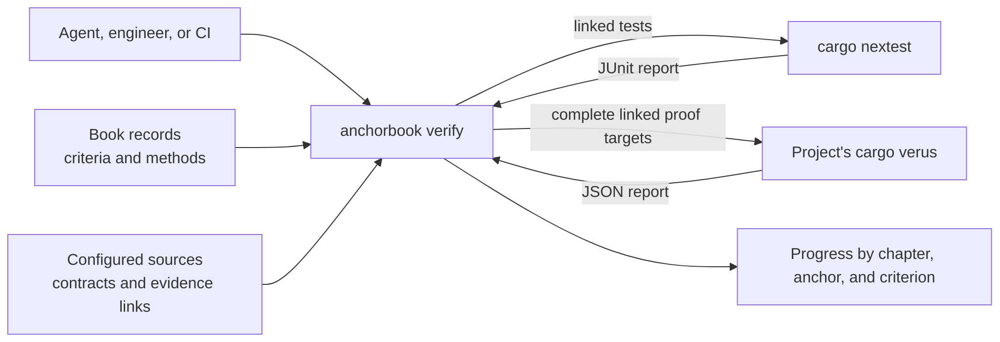

# Running Verification

**Status: draft for review.** Not implemented; the
[Verification Evidence roadmap](../implementation-roadmaps/verification-evidence.md)
plans the work.

This chapter defines the operation that produces the evidence described in
[Verification](verification.md). `anchorbook verify` reports the project's
progress toward its goal design: for
each anchor and each criterion's required methods, what current tests and proofs
establish. It finds the linked test functions and proof targets required by the
criteria in scope, runs them through the project's own tools, and reports each
criterion's state by design chapter and anchor. Proof targets are verified as
whole crates; the report distinguishes requested criteria from executed scope.

It is a status tool, not a gate. A Book describes a system that is still being
built, so unlinked or unsatisfied criteria are progress to report, not errors.
The same command serves an agent in the build loop, checking the anchor it is
working on after each change, and CI, reporting the whole Book. It complements
`check`, which evaluates Book structure only.

## Anchors

```anchorbook-anchor
schema-version = 1
id = "verify-criterion-states"
title = "Every criterion has an honest evidence state"
status = "draft"
property = '''
For every anchor criterion in the evaluated scope, and each verification method
it requires, verify reports exactly one state from a closed set. A criterion is
satisfied only when every required method has passing evidence from the current
run. Failed, inconclusive, missing, unlinked, or unevaluated evidence never counts
as satisfied, and a satisfied criterion is reported as linked tests or proofs
passing, not as proof that they are sufficient.
'''
authorities = [
  { kind = "requirement", id = "requirement-criterion-evidence" },
]

[[criteria]]
id = "state-per-method"
verification = ["test"]
statement = "Independent fixtures produce each state for test and proof methods, including criteria requiring several methods with only some satisfied; assert the per-method and per-criterion states and that only fully satisfied criteria are satisfied."

[[criteria]]
id = "scope-and-limits"
verification = ["test"]
statement = "A run scoped to fewer methods or anchors reports the excluded parts as not evaluated, never as satisfied, and every report states what a satisfied criterion does not establish."
```

```anchorbook-anchor
schema-version = 1
id = "verify-progress-report"
title = "Verify reports progress, not failure, for a Book in progress"
status = "draft"
property = '''
A completed verify run reports every anchor in scope, grouped by design chapter,
with each criterion's state and its linked tests or proofs, and summary counts of
satisfied, partial, failing, and unlinked anchors and criteria. Unsatisfied and
unlinked criteria are reported as progress and do not make the run fail; the run
fails only when it cannot evaluate the scope, such as invalid configuration, an
invalid Book, or invalid records.
'''
authorities = [
  { kind = "requirement", id = "requirement-criterion-evidence" },
]

[[criteria]]
id = "progress-output"
verification = ["test"]
statement = "For a fixture Book with satisfied, partial, failing, and unlinked anchors, the library and actual CLI report every anchor under its chapter with the expected states, links, and summary counts, and the CLI exits 0."

[[criteria]]
id = "incomplete-runs"
verification = ["test"]
statement = "Invalid configuration, structure, or records make the run incomplete with a located diagnostic and a nonzero exit; a runner that cannot build or start makes only its method inconclusive."
```

```anchorbook-anchor
schema-version = 1
id = "verify-links-resolve"
title = "Links between code and criteria cannot drift silently"
status = "draft"
property = '''
Every evidence link in the configured sources names an existing anchor criterion
that requires the link's method, and every criterion requiring a linkable method
has at least one link or is reported as unlinked. A link naming an unknown anchor
or criterion, or a criterion that does not require its method, is reported at the
link's source location.
'''
authorities = [
  { kind = "requirement", id = "requirement-criterion-evidence" },
  { kind = "decision", id = "decision-evidence-links-in-code" },
]

[[criteria]]
id = "link-findings"
verification = ["test"]
statement = "Fixtures with dangling anchor and criterion links, method mismatches, misplaced and duplicate links, and unlinked criteria each produce the expected located finding; correcting them removes it."
```

```anchorbook-anchor
schema-version = 1
id = "verify-runs-linked-checks"
title = "Verify runs linked checks in their declared scope and changes no sources"
status = "draft"
property = '''
Verify runs only the configured runners, selecting linked test functions and the
complete proof targets required by criteria in scope, and reports what actually
ran. It reads only results from that run, so its states describe the current
inputs. A linked function absent, ambiguous, or skipped in the results has no
evidence. Verify changes no Book or source files; runner output is written only
under the configured output directory.
'''
authorities = [
  { kind = "decision", id = "decision-verify-runs-linked-checks" },
]

[[criteria]]
id = "selected-run"
verification = ["test"]
statement = "With fixture runners that record their invocation, a scoped run selects exactly the linked tests and only the complete proof targets required by criteria in scope. The report identifies requested criteria, executed targets and features, and current inputs; earlier reports or changed inputs cannot produce satisfied evidence."

[[criteria]]
id = "source-preservation"
verification = ["test"]
statement = "Compare Book and source file contents and directory entries before and after passing, failing, and incomplete runs; they are unchanged, and runner output appears only under the output directory."
```

## Using verify



```sh
anchorbook verify --config anchorbook.toml [--anchor ID]... [--method test|proof]...
                  [--skip-sensitivity] [--brief]
```

In the build loop, an agent runs `verify` with `--anchor <id>` after a change to
see that anchor's criteria against the current files; `--method test` skips proof
runs while iterating on tests, and `--skip-sensitivity` skips the slowest proof
guard, leaving it `not-evaluated`. CI runs it for the whole Book with every guard.

**Brief.** `--brief` runs no tools. For each criterion in scope it prints what an
agent needs before writing or changing its tests or proof: the statement and proof
scope, the required methods, the linked functions with their identities and modes,
the current specification fingerprint and assessment record status, and each exclusion
with the criterion covering it and that criterion's linked tests. Exclusions that
name no covering criterion are listed as gaps. States that need a run are shown as
`not-evaluated`.

`verify` first reads the Book's chapters through the configured navigation and
its records through the record library. A structurally invalid Book or invalid
records make the run incomplete rather than reporting progress against them.

| Exit status | Meaning |
| --- | --- |
| `0` | The report completed, whatever the criteria's states |
| `2` | Invalid invocation, configuration, Book, or records; no progress report |

`verify` is a library capability separate from `checking`, reusing
`configuration`, `records`, and the navigation reader. The library selects
functions, invokes runners, interprets their output, and returns the report as
typed data; the CLI handles invocation and presentation.

[Verification](verification.md#responsibilities) divides the work between the
project, Verus, Anchor Book, and review. Successful function verification does
not establish that its contract expresses the criterion or covers the system's
runtime path; the [guards](verification.md#guards) and the specification assessment
address that. A criterion requiring tests or review remains unsatisfied until
those methods also have evidence.

## Evidence links

A link is a comment line in source code naming one anchor criterion:

```rust
// anchorbook: A-check-observation-only#file-preservation
#[test]
fn checks_preserve_files_and_directory_entries() { /* ... */ }
```

The line `// anchorbook: <anchor-id>#<criterion-id>` applies to the next function
item, with only attributes and further link lines between them. One function may
link several criteria, one per line. A link claims that the function addresses
the criterion; it does not show that the function is sufficient. Links are read
only from the configured source directories, and the engine derives the reverse
view from each criterion to its linked functions. Keeping links beside the code
means renaming or moving a function moves its link, and the Book records only
criteria.

**Method.** An ordinary function marked `#[test]` links the `test` method. A Verus
executable function with a verified contract, or a verified proof function, links
the `proof` method. A specification supplies claim context; its declaration alone
is not passing evidence. Membership in a `verus!` block does not determine the
function's mode. A misplaced link, or a link on an unsupported function form, is
a located finding.

**Witnesses.** A verified function whose link line ends with `witness <function>`
is the [vacuity witness](verification.md#verify-proof-nonvacuous) for the named
linked function of the same criterion. It constructs an input and calls that
function with it, so Verus checks the call against the function's preconditions;
a witness whose input cannot meet them fails verification. The runner confirms
that the witness calls the named function rather than trusting the link. A
witness is executable code that the system never runs, so the project compiles it
only under verification, for example with `#[cfg(verus_keep_ghost)]` and that cfg
declared for Rust's `unexpected_cfgs` check. [Milestone 7](../implementation-roadmaps/verification-evidence.md#verification-evidence-7)
established this form on the engine's `validate_reference`.

**Identity.** Each linked function is resolved by package, crate target, module
path, name, and verification mode, with its source location, and must match
exactly one result for the selected target and features. Equal names in different
modules or packages never select an arbitrary result; unsupported,
macro-generated, or ambiguous identities are reported rather than guessed. The
first implementation supports simple module functions and declares its limits
before extending to other forms. Recognizing modes requires parsing inside
`verus!` bodies, which ordinary Rust parsers such as `syn` leave as macro tokens.
The parser and its dependencies are selected and reviewed under the
[Rust dependency conventions](rust-engine.md#rust-development-conventions) and
the [proof-isolation goal](verified-code-packaging.md#proof-packaging-for-consumers).

## Evidence states

For each criterion in scope, each required method gets exactly one state. States
describe the current run only: reports from earlier runs are never inputs, and
inputs that change during the run make affected evidence inconclusive whatever
the runner reported.

| State | Test method | Proof method | Review method |
| --- | --- | --- | --- |
| `satisfied` | Every linked test passed once | Every required target has a [complete result](#verus-runner), each linked function verified once in its expected mode, and every [guard](#proof-guards) holds | A current accepting assessment record |
| `failed` | A linked test failed | A linked function or its witness failed verification, the target violated the trust policy, a sensitivity survivor is unclassified, or the specification assessment rejects it | The current assessment record rejects the criterion |
| `inconclusive` | The runner could not build or run, or its results are malformed | Without a failure above: a required target has no complete result, it has verification failures outside the criterion's links (listed in the report), or a sensitivity run timed out | Never |
| `no-evidence` | A linked test was absent, ambiguous, or skipped in usable results | A linked function was absent, ambiguous, in the wrong mode, or skipped in a complete result; a precondition has no witness; or the specification assessment is missing or stale | The assessment record is missing or stale |
| `unlinked` | No test link names the criterion | No proof link names the criterion | Never |
| `not-evaluated` | Outside the requested scope, or the runner is unavailable or unsupported | Outside the requested scope, the runner is unavailable or unsupported, or sensitivity was skipped | Outside the requested scope |

Only `satisfied` counts as evidence. A criterion is `satisfied` when every
required method is satisfied, `partial` when some are, and otherwise takes the
first applicable state in the order `failed`, `inconclusive`, `no-evidence`,
`unlinked`, `not-evaluated`. An anchor is satisfied when all its criteria are,
partial when some are, and otherwise takes the same order.

The `review` method runs nothing: `verify` reads the criterion's
[assessment records](verification.md#assessment-records) and compares their fingerprints
with the current sources.

## Running linked checks

`verify` runs only the configured runners, invoked the way the engine documents,
and reads only that run's output, written under the configured output directory.
A runner that is not installed leaves its method `not-evaluated`, with the reason.
A runner that cannot build or produces no usable report leaves its method
`inconclusive`. Neither stops the rest of the report.

### Test runner

| Run | Evidence for a link |
| --- | --- |
| `cargo nextest run` with a JUnit report, an exact filter for the linked tests, and ignored tests included | The linked test's report entry is present once, without `failure`, `error`, or `skipped` |

Stable `cargo test` has no machine-readable per-test output, so test runs use
nextest. The engine maps a linked test to its report entry by Cargo's and
nextest's naming: integration tests by their `tests/` file and function, unit
tests by their module path in the library. A link that maps to no entry, or to
several, has no evidence and is reported.

### Verus runner

**Tools.** The project selects its Verus installation and verification toolchain
separately from its build toolchain. The runner checks the actual verifier
identity against the configured version and a supported report adapter. Support
starts with the release pinned for the engine's
[authority proof](rust-engine.md#authority-proof); another version is added only with
real passing and failing report fixtures and native-run acceptance. An
unsupported report version makes the proof method `inconclusive`.

**Scope.** Verus verifies whole crate targets, so a proof criterion in scope
selects its complete configured target, run with `cargo verus verify` and JSON
output. An anchor filter narrows the reported criteria, not the proof obligations
inside the target. Each required target runs once, and the report discloses its
package, target, and features, including verification beyond the requested
criteria. Other workspace and target forms require measured support; a
successful library-target run does not imply them.

**Complete result.** A target result is complete when the command succeeds and a
supported report shows full-target verification with nonzero coverage and zero
verification errors. A successful command that produces no new report is not a
result. Missing, duplicate, skipped, partial, or malformed evidence never
satisfies the method.

**Linked and supporting failures.** Verus checks each function separately, using
the [contracts](https://verus-lang.github.io/verus/guide/requires_ensures.html)
of the functions it calls, so a linked caller can verify while a supporting
lemma's own proof fails. A linked function's own failure, or a trust-policy
violation, makes the method `failed`. A failure elsewhere in the target makes a
criterion linked only to passing functions `inconclusive`, and the report lists
the failing obligations and their locations. This directs repair without treating
a passing caller as established evidence.

**Trust policy.** The runner uses the engine proof's `--no-cheating` policy
initially. In the pinned release it rejects `assume`, `admit`,
`#[verifier::external_body]`, the project's own `assume_specification`,
`#[verifier::assume_termination]`, and calls to undeclared external functions in
the crates it applies to. It does not cover the contracts of `vstd` and other
dependencies, their broadcast lemmas, or dependency crates verified without the
flag. For each supported version, rejection of deliberate assumptions and trusted
project bodies is demonstrated before the policy is claimed. Reports record the
trusted compiler, verifier, solver, standard-library, and dependency contracts;
zero errors alone cannot establish the absence or adequacy of assumptions.
Unproved conversions, callers, diagnostics, and other excluded behavior keep
their test or review obligations.

**Fresh runs.** Proof runs use fresh target and report directories under the
configured output, with locked dependencies. Cache reuse is introduced only after
measuring runtime, with explicit applicability checks, and never silently
consumes an earlier report.

**Adapter.** Raw Verus report parsing stays private to the adapter, which
normalizes results into the typed evidence model used for tests. The expected
functions come from resolved links, in executable and proof modes. The engine's
`.github/verus-report.jq`, which checks its own seven executable functions, is a
starting fixture, not a function inventory for other projects.

### Proof guards

The [guards](verification.md#guards) run after the target's own result is
complete; a target that does not verify gets no guard results.

**Sensitivity.** For each linked executable function, the runner generates
changes to its executable statements and expressions: negated or constant
conditions, swapped comparison and boolean operators, replaced return values,
replaced arguments and constructed field values, replaced enum variants, and
removed calls that change state. Specifications, proof blocks, invariants, and
proof functions are not changed: a changed specification can only alter rules it
states, and every weakening still verifies, so only changes to code reveal
behavior the specification leaves unconstrained. Each change is applied in a fresh copy and
the complete target is verified once. A change that fails verification is
reported with the obligation that failed; one rejected only by overflow, bounds,
or termination obligations is reported as such, since the claim did not detect
it. A change that verifies is a survivor. The runner then runs the linked tests
of the criteria named in the exclusions against each survivor; a survivor they
detect is classified as excluded, and one listed as equivalent in the current
specification assessment is classified as equivalent. Changes are identified by
function, location, and original and replacement text, so a listing that no
longer matches classifies nothing. Changes that do not build are unviable;
timeouts are inconclusive. The number of changes and the time budget are reported.
Ordinary mutation tools find no mutations inside `verus!` bodies, so the runner
generates these changes with the same parser that reads links and modes.

**Witnesses.** Each linked function with preconditions needs a linked witness
that verified in the same complete result. The report lists functions without
one.

**Fingerprints.** The specification fingerprint covers the criterion's statement
and proof scope, the signatures and contracts of its linked functions, and the
definitions of every specification function and type those contracts reach,
followed transitively. It is computed from tokens, so comments and formatting do
not change it; executable and proof bodies are excluded. The brief and report
show the fingerprint so a reviewer can record it.

**Assessment records.** The runner reads the records for the criteria in scope from
the configured assessment directory, rejects malformed or duplicate records as
located findings, and treats a record whose fingerprints differ from the current
ones as stale.

## Report

The report lists chapters in navigation order, and under each its anchors and
criteria:

```text
anchorbook verify: progress
scope: all anchors; methods test, proof; review not evaluated

Structural Checking (design/structural-checking.md)
  A-check-observation-only (draft) — partial, 1 of 2 criteria
    file-preservation [test]: satisfied — 3 linked tests passed
    no-execution [test]: unlinked
  A-check-navigation-conformance (draft) — unlinked

summary: 18 anchors: 1 satisfied, 2 partial, 0 failing, 15 unlinked
         41 criteria: 5 satisfied, 1 failed, 35 unlinked
satisfied means linked tests and proofs passed in this run; it does not show
they are sufficient, and review is not evaluated
files changed: none (runner output under target/anchorbook-verify)
```

Link findings, failed tests, and inconclusive runners appear in the report and do
not change the exit status. Reports follow the
[diagnostics conventions](check-diagnostics.md) for codes, locations,
deterministic order, and output without color.

### Run identity

Each result retains the information needed to assess its scope:

| Information | Content |
| --- | --- |
| Inputs | Content identities for the evaluated criteria, configuration, code, and lockfile; revision and dirty state when Git is available. |
| Selection | Requested anchors and methods, actual packages/targets/features, and resolved function identities and modes. |
| Execution | Run identity, executed argument vector, exit status, and actual verifier, solver, and Rust toolchain versions. |
| Evidence | Target completeness, per-function results, assumptions, exclusions, and source locations; specification fingerprints and the assessment records read; sensitivity changes, their outcomes, and their classifications. |

A Git revision alone does not identify uncommitted inputs, so relevant inputs are
snapshotted before and after execution. Local execution remains usable without
Git. Retained public artifacts omit private machine paths and raw source or
proof-note payloads.

## Configuration

```toml
[verification]
sources = ["src", "tests"]
output = "target/anchorbook-verify"
assessments = "verification/assessments"
runners = ["nextest", "verus"]
```

`sources` are the directories scanned for links; `output` is where runner reports
are written; `assessments` holds the project's [assessment records](verification.md#assessment-records);
`runners` lists the supported runners the project uses. Paths follow the existing
[path rules](configuration.md#paths). `output` must be separate from the Book, the
configured source directories, and `assessments`; `assessments` must be outside the Book. The section is required for
`verify` and ignored by `check`; its absence makes `verify` incomplete.

A project that verifies its own code also identifies here its Verus installation,
expected verifier version, verification Rust toolchain, and the manifest,
package, crate target, and features to verify;
[Project Integration](project-integration.md#formal-verification-in-a-project)
defines that use. Project manifests and source paths follow the containment rules
above; an explicitly selected tool installation may be outside the project root.
The exact proof-runner fields and supported target forms are settled against
native Verus runs in
[milestone 2](../implementation-roadmaps/verification-evidence.md#verification-evidence-2).

## Boundaries

- `verify` adds selection by criterion to the project's existing tools; it does
  not replace `cargo test`, the project's CI test jobs, or their commands.
- Its states describe linked results, not the property. Passing tests may still
  miss part of a criterion; sufficiency stays a `review` obligation.
- [Mutation testing](verification.md#tests-that-match-the-design) assesses test
  sensitivity and is not evidence for any method.
- Results are not written into Book sources. A rendered progress view, if added,
  is derived from a CI `verify` report at build time.

## Open questions

1. **Rendered progress.** Whether the published Book shows states beside criteria,
   derived from the CI report.
2. **When unsatisfied criteria fail.** Whether declared maturity turns states into
   failures: for example, in the `complete` [project phase](configuration.md#project-phase)
   every criterion in scope must be satisfied, or a design area or anchor marked
   `complete` must have all its criteria satisfied while the rest of the Book stays
   in progress. Completion is a separate axis from design acceptance (`draft` or
   `accepted`): it claims the part is implemented and verified, which `verify` would
   enforce. This would replace any separate CI gating option and needs a completion
   marker below the project level, which does not exist yet.
3. **Machine-readable output.** The versioned artifact schema for tools and agents,
   planned with [CI reporting](../implementation-roadmaps/verification-evidence.md#verification-evidence-3).
4. **Other languages and runners.** Link forms and runners beyond Rust, nextest,
   and Verus.
5. **Sensitivity cost.** Each change verifies the complete target once. For the
   engine's authority proof this took 1–2 seconds per change, so its full set runs
   in under a minute; much larger targets may still need a sampling or
   per-function selection policy that reports which changes were not tried.
