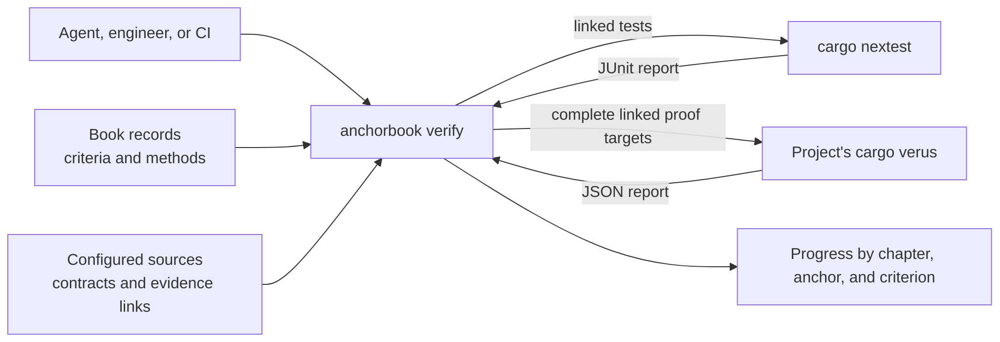

# Verification Evidence

**Status: draft for review.** Not implemented; the
[Verification Evidence roadmap](../implementation-roadmaps/verification-evidence.md)
plans the work.

`anchorbook verify` reports the project's progress toward its goal design: for
each anchor and each criterion's required methods, what current tests and proofs
establish. It finds the linked test functions and proof targets required by the
criteria in scope, runs them through the project's own tools, and reports each
criterion's state by design chapter and anchor. Proof targets are verified as
whole crates; the report distinguishes requested criteria from executed scope.

It is a status tool, not a gate. A Book describes a system that is still being
built, so unlinked or unsatisfied criteria are progress to report, not errors.
The same command serves an agent in the build loop, checking the anchor it is
working on after each change, and CI, reporting the whole Book. It complements
`check`, which evaluates Book structure only.

## Anchors

```anchorbook-anchor
schema-version = 1
id = "verify-criterion-states"
title = "Every criterion has an honest evidence state"
status = "draft"
property = '''
For every anchor criterion in the evaluated scope, and each verification method
it requires, verify reports exactly one state from a closed set. A criterion is
satisfied only when every required method has passing evidence from the current
run. Failed, inconclusive, missing, unlinked, or unevaluated evidence never counts
as satisfied, and a satisfied criterion is reported as linked tests or proofs
passing, not as proof that they are sufficient.
'''
authorities = [
  { kind = "requirement", id = "requirement-criterion-evidence" },
]

[[criteria]]
id = "state-per-method"
verification = ["test"]
statement = "Independent fixtures produce each state for test and proof methods, including criteria requiring several methods with only some satisfied; assert the per-method and per-criterion states and that only fully satisfied criteria are satisfied."

[[criteria]]
id = "scope-and-limits"
verification = ["test"]
statement = "A run scoped to fewer methods or anchors reports the excluded parts as not evaluated, never as satisfied, and every report states what a satisfied criterion does not establish."
```

```anchorbook-anchor
schema-version = 1
id = "verify-progress-report"
title = "Verify reports progress, not failure, for a Book in progress"
status = "draft"
property = '''
A completed verify run reports every anchor in scope, grouped by design chapter,
with each criterion's state and its linked tests or proofs, and summary counts of
satisfied, partial, failing, and unlinked anchors and criteria. Unsatisfied and
unlinked criteria are reported as progress and do not make the run fail; the run
fails only when it cannot evaluate the scope, such as invalid configuration, an
invalid Book, or invalid records.
'''
authorities = [
  { kind = "requirement", id = "requirement-criterion-evidence" },
]

[[criteria]]
id = "progress-output"
verification = ["test"]
statement = "For a fixture Book with satisfied, partial, failing, and unlinked anchors, the library and actual CLI report every anchor under its chapter with the expected states, links, and summary counts, and the CLI exits 0."

[[criteria]]
id = "incomplete-runs"
verification = ["test"]
statement = "Invalid configuration, structure, or records make the run incomplete with a located diagnostic and a nonzero exit; a runner that cannot build or start makes only its method inconclusive."
```

```anchorbook-anchor
schema-version = 1
id = "verify-links-resolve"
title = "Links between code and criteria cannot drift silently"
status = "draft"
property = '''
Every evidence link in the configured sources names an existing anchor criterion
that requires the link's method, and every criterion requiring a linkable method
has at least one link or is reported as unlinked. A link naming an unknown anchor
or criterion, or a criterion that does not require its method, is reported at the
link's source location.
'''
authorities = [
  { kind = "requirement", id = "requirement-criterion-evidence" },
  { kind = "decision", id = "decision-evidence-links-in-code" },
]

[[criteria]]
id = "link-findings"
verification = ["test"]
statement = "Fixtures with dangling anchor and criterion links, method mismatches, misplaced and duplicate links, and unlinked criteria each produce the expected located finding; correcting them removes it."
```

```anchorbook-anchor
schema-version = 1
id = "verify-runs-linked-checks"
title = "Verify runs linked checks in their declared scope and changes no sources"
status = "draft"
property = '''
Verify runs only the configured runners, selecting linked test functions and the
complete proof targets required by criteria in scope, and reports what actually
ran. It reads only results from that run, so its states describe the current
inputs. A linked function absent, ambiguous, or skipped in the results has no
evidence. Verify changes no Book or source files; runner output is written only
under the configured output directory.
'''
authorities = [
  { kind = "decision", id = "decision-verify-runs-linked-checks" },
]

[[criteria]]
id = "selected-run"
verification = ["test"]
statement = "With fixture runners that record their invocation, a scoped run selects exactly the linked tests and only the complete proof targets required by criteria in scope. The report identifies requested criteria, executed targets and features, and current inputs; earlier reports or changed inputs cannot produce satisfied evidence."

[[criteria]]
id = "source-preservation"
verification = ["test"]
statement = "Compare Book and source file contents and directory entries before and after passing, failing, and incomplete runs; they are unchanged, and runner output appears only under the output directory."
```

## Flow



In the build loop, an agent runs
`anchorbook verify --config anchorbook.toml --anchor <id>` after a change to see
that anchor's criteria against the current files. CI runs it for the whole Book.

## Responsibilities

| Owner | Responsibility |
| --- | --- |
| Project | Declare each criterion's claim and scope, maintain formal specifications beside production code, and choose its tools and verification targets. |
| Verus | Verify the selected code against its formal contracts under the recorded assumptions. |
| Anchor Book | Resolve criterion associations, plan and execute supported runners, normalize results, and report evidence states and limits. |
| Review | Assess specification fidelity, caller preconditions, production-code correspondence, and coverage of excluded boundaries. |

The required [proof scope](anchor-definitions.md#required-scope-of-a-proof-criterion)
remains the project's statement of the claim, domain, boundary, assumptions, and
exclusions. Successful function verification does not establish that its contract
expresses that claim or covers the system's runtime path. A criterion requiring
tests or review remains unsatisfied until those methods also have evidence.

## Evidence links

A link is a comment line in source code naming one anchor criterion:

```rust
// anchorbook: A-check-observation-only#file-preservation
#[test]
fn checks_preserve_files_and_directory_entries() { /* ... */ }
```

The line `// anchorbook: <anchor-id>#<criterion-id>` applies to the next function
item, with only attributes and further link lines between them. One function may
link several criteria, one per line. A link is a claim that the function
addresses the criterion; it does not show that the test is sufficient.

An ordinary function marked `#[test]` links the `test` method. A Verus executable
function with a verified contract or a verified proof function links the `proof`
method. A specification supplies claim context; its declaration alone is not
passing evidence. Membership in a `verus!` block does not determine the function's
mode. A misplaced link or a link on an unsupported function form is a located
finding. Links are read only from the configured source directories.

Resolve each linked function by package, crate target, module path, name, and
verification mode, with its source location. Match that identity to exactly one
result for the selected target and features. Equal function names in different
modules or packages must not select an arbitrary result. Use Rust-aware source
inspection for supported forms; report unsupported macro-generated or ambiguous
identities rather than guessing. The first implementation supports simple module
functions and declares its limits before extending to other forms.

Select and record the source parser under the
[Rust dependency conventions](rust-engine.md#rust-development-conventions).
An ordinary Rust parser such as `syn` leaves a `verus!` body's contents as macro
tokens; recognizing Verus modes and function identities needs additional parsing.
Establish that support with source fixtures and review any parser dependencies
against the engine's [proof-isolation goal](formal-verification.md#proof-packaging-for-consumers).

Links stay beside the code they describe so that renaming or moving a test moves
its link, and the Book records only criteria. The engine derives the reverse
view, from each criterion to its linked functions.

## Running linked checks

`verify` selects the linked functions for the criteria in scope and runs them
through runners the engine supports, invoked the way the engine documents:

| Method | Runner | Run | Evidence for a link |
| --- | --- | --- | --- |
| `test` | `nextest` | `cargo nextest run` with a JUnit report, an exact filter for the linked tests, and ignored tests included | The linked test's report entry is present once, without `failure`, `error`, or `skipped` |
| `proof` | `verus` | `cargo verus verify` with JSON output, for each complete selected crate target | A supported report shows complete-target verification and zero errors, with each linked function verified once in its expected mode under the trust policy |

Stable `cargo test` has no machine-readable per-test output, so test runs use
nextest. The engine maps a linked test to its report entry from its file and
function name using Cargo's and nextest's naming: integration tests by their
`tests/` file and function, and unit tests by their module path in the library.
A link that maps to no entry, or to several, has no evidence and is reported.
Any linked proof criterion in scope selects its complete configured crate target.
An anchor filter narrows reported criteria, not the proof obligations inside that
target. Run each required target once and disclose its package, target, and
features, including verification beyond the requested criteria. Additional
workspace and target forms require measured support; they are not inferred from
a successful library-target run.

A runner that is not installed leaves its method not evaluated, with the reason.
A runner that cannot build or exits without a usable report leaves its method
inconclusive. Neither stops the rest of the report.

The `review` method has no runner; see [open questions](#open-questions). Criteria
requiring `review` report that method as not evaluated.

## Verus runner

The project selects its Verus installation and verification toolchain separately
from its build toolchain. The runner validates the actual verifier identity against
the configured version and a supported report adapter. Start with the release
pinned for the engine's [authority proof](formal-verification.md); add versions
only with real passing and failing report fixtures and native-run acceptance.
An unsupported report version makes the proof method inconclusive.

Keep raw Verus parsing private to the adapter and normalize results into the same
typed evidence model used for tests. The engine's
`.github/verus-report.jq` is a starting fixture for its own seven executable
functions, not the consumer function inventory. Expected consumer functions come
from resolved links, including executable and proof modes.

Classify results using the [evidence states](#evidence-states). Verus checks
functions independently, using called functions'
[contracts](https://verus-lang.github.io/verus/guide/requires_ensures.html).
A linked caller can pass while a supporting lemma's own proof fails. Until all
obligations in its target pass, a criterion linked only to that caller is
inconclusive; the report lists the failing obligations and their locations.
A linked function's own verification failure or a trust-policy violation is
failed. This distinction directs repair without treating a passing caller as
established evidence.

Use the engine proof's `--no-cheating` policy initially. For each supported
version, demonstrate rejection of deliberate assumptions and trusted project
bodies before claiming that policy holds. Record trusted compiler, verifier,
solver, standard-library, and external contracts; zero errors alone cannot
establish the absence or adequacy of assumptions. Unproved conversions, callers,
diagnostics, and other excluded behavior retain their test or review obligations.

The first native proof runs use fresh target and report directories under the
configured output, locked dependencies, and complete target verification. A
successful Cargo invocation with no new proof report has no passing evidence.
Measure runtime before introducing cache reuse; any later reuse needs explicit
applicability checks and cannot silently consume an earlier report.

## Run identity

Each result retains the information needed to assess its scope:

| Information | Content |
| --- | --- |
| Inputs | Content identities for the evaluated criteria, configuration, code, and lockfile; revision and dirty state when Git is available. |
| Selection | Requested anchors and methods, actual packages/targets/features, and resolved function identities and modes. |
| Execution | Run identity, executed argument vector, exit status, and actual verifier, solver, and Rust toolchain versions. |
| Evidence | Target completeness, per-function results, assumptions, exclusions, and source locations. |

Git revision alone does not identify uncommitted inputs. Snapshot relevant inputs
before and after execution; changed inputs make affected evidence inconclusive.
Reports from earlier runs are not inputs to this operation. Local execution
remains usable without Git. Retained public artifacts omit private machine paths
and raw source/proof-note payloads.

## Evidence states

For each criterion in scope, each required method gets one state:

All results must come from the current run with unchanged inputs. Changed inputs
make affected evidence inconclusive, regardless of the runner's result.

| State | Test method | Proof method |
| --- | --- | --- |
| `satisfied` | Every linked test passed once | Every required target has a successful command and supported complete report with nonzero coverage, zero verification errors, and exactly one verified result in the expected mode for each linked function; the trust policy holds |
| `failed` | A linked test failed | A linked function fails verification, or a target violates the trust policy |
| `inconclusive` | Build/tool failure without usable results, or malformed results | An unsuccessful command without a linked verification or trust-policy failure; unusable, unsupported, malformed, empty, partial, or zero-coverage reports; or target failures outside the criterion's links, with the failing obligations listed |
| `no-evidence` | A linked test was absent, ambiguous, or skipped in usable results | A linked function was absent, ambiguous, in the wrong mode, or skipped in otherwise successful target results |
| `unlinked` | No test link names the criterion | No proof link names the criterion |
| `not-evaluated` | Outside the requested scope, or runner unavailable or unsupported | Outside the requested scope, or runner unavailable or not yet supported |

Only `satisfied` counts as evidence. A criterion is `satisfied` when every
required method is satisfied, `partial` when some are, and otherwise takes the
first applicable state in the order `failed`, `inconclusive`, `no-evidence`,
`unlinked`, `not-evaluated`. An anchor is satisfied when all its criteria are,
partial when some are, and otherwise takes the same order.

## Command and report

```sh
anchorbook verify --config anchorbook.toml [--anchor ID]... [--method test|proof]...
```

`verify` first reads the Book's chapters through the configured navigation and
its records through the record library. A structurally invalid Book or invalid
records make the run incomplete rather than reporting progress against them.

The report lists chapters in navigation order, and under each its anchors and
criteria:

```text
anchorbook verify: progress
scope: all anchors; methods test, proof; review not evaluated

Structural Checking (design/structural-checking.md)
  A-check-observation-only (draft) — partial, 1 of 2 criteria
    file-preservation [test]: satisfied — 3 linked tests passed
    no-execution [test]: unlinked
  A-check-navigation-conformance (draft) — unlinked

summary: 18 anchors: 1 satisfied, 2 partial, 0 failing, 15 unlinked
         41 criteria: 5 satisfied, 1 failed, 35 unlinked
satisfied means linked tests and proofs passed in this run; it does not show
they are sufficient, and review is not evaluated
files changed: none (runner output under target/anchorbook-verify)
```

| Exit status | Meaning |
| --- | --- |
| `0` | The report completed, whatever the criteria's states |
| `2` | Invalid invocation, configuration, Book, or records; no progress report |

Link findings, failed tests, and inconclusive runners appear in the report and do
not change the exit status. Reports follow the
[diagnostics conventions](check-diagnostics.md) for codes, locations, deterministic
order, and output without color. The library returns the same report as typed data.

`verify` is a separate library capability from `checking`, reusing
`configuration`, `records`, and the navigation reader. The library selects tests,
invokes runners, and interprets their output; the CLI handles invocation and
presentation.

## Configuration

```toml
[verification]
sources = ["src", "tests"]
output = "target/anchorbook-verify"
runners = ["nextest", "verus"]
```

`sources` are the directories scanned for links; `output` is where runner reports
are written; `runners` lists the supported runners the project uses. Paths follow
the existing [path rules](configuration.md#paths), and `output` must be separate
from the Book and configured source directories. The section is required for
`verify` and ignored by `check`;
its absence makes `verify` incomplete.

A project that verifies its own code also identifies its Verus installation,
expected verifier version, verification Rust toolchain, and manifest, package,
crate target, and features here. [Project Integration](project-integration.md#formal-verification-in-a-project)
defines that use. Project manifests and source paths follow the containment rules
above; an explicitly selected tool installation may be outside the project root.
The exact proof-runner fields and supported target forms are settled by
[milestone 2](../implementation-roadmaps/verification-evidence.md#verification-evidence-2)
against native Verus runs before assignment of the complete runner.

The [shared foundation](../implementation-roadmaps/verification-evidence.md#verification-evidence-4)
provides configuration, links, evidence states, and typed reporting before either
runner. Test and proof runners can then be implemented independently. The
[consumer acceptance milestone](../implementation-roadmaps/verification-evidence.md#verification-evidence-5)
exercises packaged use after engine proof dependencies are isolated.

## Boundaries

- `verify` adds selection by criterion to the project's existing tools; it does
  not replace `cargo test`, the project's CI test jobs, or their commands.
- Its states describe linked results, not the property. Passing tests may still
  miss part of a criterion; sufficiency stays a `review` obligation.
- Mutation results assess test sensitivity and are not evidence for any method.
- Results are not written into Book sources. A rendered progress view, if added,
  is derived from a CI `verify` report at build time.

## Open questions

1. **Review evidence.** How a review is recorded so `verify` can read it: what was
   examined, the conclusion, the reviewer, and the revision.
2. **Rendered progress.** Whether the published Book shows states beside criteria,
   derived from the CI report.
3. **When unsatisfied criteria fail.** Whether declared maturity turns states into
   failures: for example, in the `complete` [project phase](configuration.md#project-phase)
   every criterion in scope must be satisfied, or a design area or anchor marked
   `complete` must have all its criteria satisfied while the rest of the Book stays
   in progress. Completion is a separate axis from design acceptance (`draft` or
   `accepted`): it claims the part is implemented and verified, which `verify` would
   enforce. This would replace any separate CI gating option and needs a completion
   marker below the project level, which does not exist yet.
4. **Machine-readable output.** The versioned artifact schema for tools and agents,
   planned with [CI reporting](../implementation-roadmaps/verification-evidence.md#verification-evidence-3).
5. **Other languages and runners.** Link forms and runners beyond Rust, nextest,
   and Verus.
