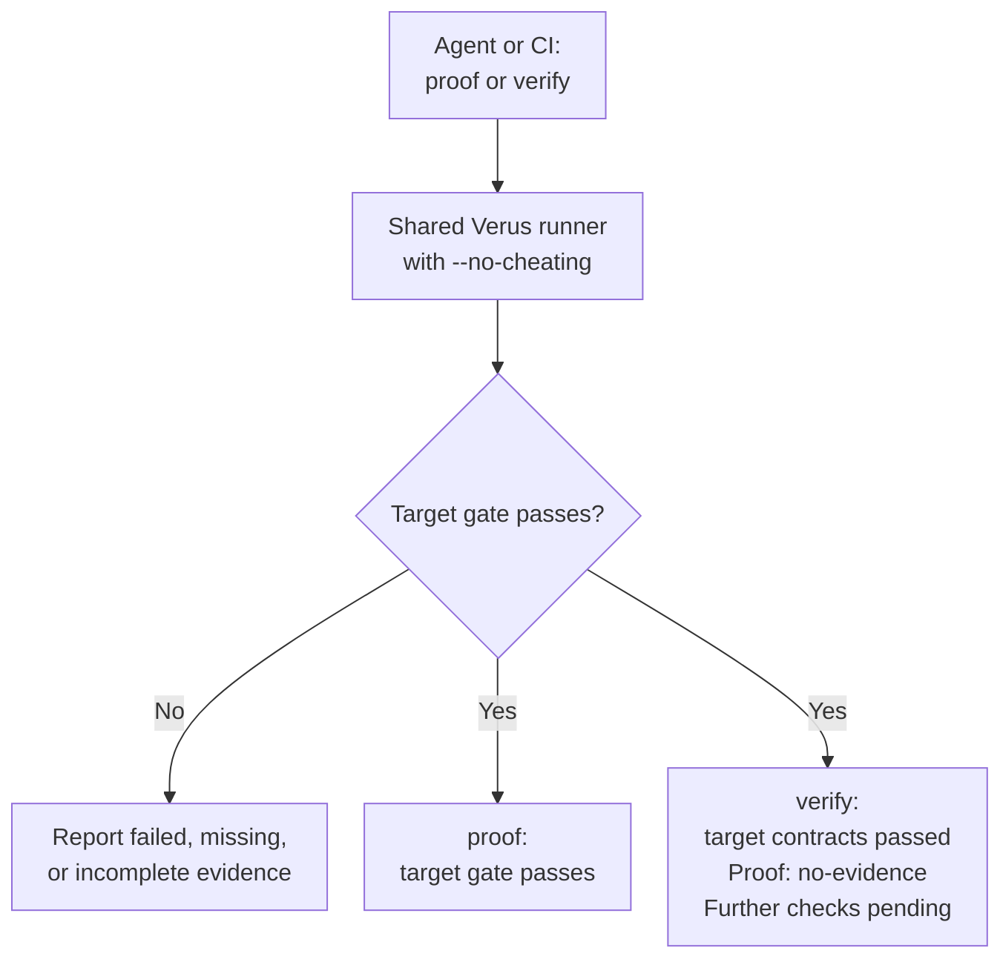

# Working on Anchor Book

This chapter provides the project-specific context for developing the Anchor Book
engine with its own Book. Read it after the AI Working Contract, which `AGENTS.md`
directs agents to retrieve with `anchorbook contract`.
The contract defines the reusable working method; this chapter identifies the
current state and resources for applying it in this repository.

## Book sources and authoring references

Read `book/SUMMARY.md` and every chapter it lists from the current checkout.
Edit sources under `book/`; generated output belongs in `target/anchorbook/`.

Use these definitions and conventions while authoring this Book:

- [Anchor Definitions](design/anchor-definitions.md) defines the goal record syntax
  and anchor fields.
- [Authority Definitions](design/authority-definitions.md) defines requirements,
  decisions, and authority-reference rules.
- [Requests for Discussion](design/rfds.md) defines optional proposal structure,
  review disposition, and relationships across design and implementation work.
- [RFD Source Format](design/rfd-format.md) specifies the proposed schema-2
  extension, format-1 blocks, templates, and compatibility. These are design
  targets; use the implementation state below to determine supported commands.
- The [Glossary](glossary.md) lists the Book's terms. Use them in text and
  identifiers; propose a new term to the engineer before introducing it.
- [Implementation Roadmaps](implementation-roadmaps/index.md) defines milestone
  structure, identifiers, planned coverage, statuses, and evidence records.

Write records in the [record syntax](design/anchor-definitions.md#record-syntax),
following the existing records; the engine reads no other form.

The record syntax and fields are unpublished drafts that we are refining through use.
Follow their documented evolution policy and update the syntax, affected records,
and validation expectations together. Per-capability phase configuration is not
currently defined.

## Current phase

Read `[project].phase` in the repository-root `anchorbook.toml` for the current
phase. That file is the single authoritative setting; this chapter does not
repeat its value. The configuration reader validates the field without inferring
design acceptance, implementation progress, or completion.

## Available tools and checks

The record library, configuration loader, structural checker, and `anchorbook md`
preprocessor are implemented. Run `anchorbook check --config anchorbook.toml` to
inspect this Book's format; the checker reports findings without repairing files.
The binary also supports `anchorbook md supports html`, `anchorbook contract`,
`anchorbook verify --config anchorbook.toml`, help, and version. `verify --format json` emits structured current results on standard output; text
remains the default, and neither format creates report history. `verify` reports
each anchor criterion's evidence state and checks the Book's claims of completion;
it runs linked tests with cargo-nextest and configured library proofs with Verus,
which CONTRIBUTING describes installing. `anchorbook proof --config anchorbook.toml`
uses the same Verus runner as a strict proof-target gate. Target success leaves
criterion assessments and guards outstanding. This Book's tests are linked to its anchors' criteria
with `/// anchorbook:` doc comments. Materialization remains planned. Loading configuration
alone does not check Book format.

The contract includes conditional RFD guidance. The optional RFD role, source
format reader, broader Book relationship index, template commands, and RFD views are planned in the
[RFD roadmap](implementation-roadmaps/rfds.md); the current engine does not check
those relationships. This Book does not enable RFD support; the planned optional
book.sections.rfds setting must be implemented before adding it to configuration.
Its RFD design chapter defines the capability, not an active proposal collection.

The RFD design specifies proposal-scoped definitions and the repository contains
template sources under templates/rfds. Template commands and proposal validation
are not implemented. For now, illustrative definitions belong in fenced Markdown
examples and have no typed proposal validation. Do not place ordinary anchor
blocks in an RFD and assume that marking them draft keeps them out of the current
record inventory.

The test runner trusts project test outcomes as described in
[Trusting project test results](design/verification-evidence.md#trusting-project-test-results).
Symposium owns the semantics of its agent-mode tests. No additional execution
report protocol or agent instrumentation is required by Anchor Book.

Read `CONTRIBUTING.md` at the repository root for the supported Rust and mdBook
versions and exact commands for tests, formatting, Clippy, builds, and previews.
The [Rust Engine design](design/rust-engine.md) describes package and API boundaries.
Use current stable Rust for development; `rust-toolchain.toml` selects that
channel. Rust 1.88 is the minimum tested in CI. The verifier continues to use
its separately pinned toolchain.

Engine verification uses independent fixtures and a separate acceptance test
against this Book. For engine changes, exercise the supported Rust toolchains and
checks relevant to the work. For Book changes, build it and check rendered records,
links, and affected diagrams. Engine compilation and independent tests must remain
usable when this Book is broken.

The Book workflow calls the reusable Engine workflow before its build job.
`mdbook build` runs the structural check in the Anchor Book preprocessor before
rendering; rendered-output acceptance then gates publication.

The contract's pre-PR testing policy is being developed during prototyping.
Mutation testing uses pinned cargo-mutants with local commands and a pull-request
workflow; read `CONTRIBUTING.md` for scope, runtime budgets, results, and the
agent correction loop. The **Protect main** ruleset requires the engine, Book,
installed-engine, proof, and mutation checks to pass, for a revision current with
`main`, before a pull request merges; CONTRIBUTING lists the check names, and the
[Mutation Testing roadmap](implementation-roadmaps/mutation-testing.md#mutation-testing-2-enforcement-evidence)
records the demonstration.

The [authority proof](design/rust-engine.md#authority-proof) is a Verus proof of the
production authority-validation functions, run locally and in a GitHub workflow.
Its [roadmap](implementation-roadmaps/formal-verification.md) records evidence and
remaining work. CONTRIBUTING documents the pinned tools, native command, and mutation-coverage gap.
Criterion-level required methods are supported by
the record parser and renderer; they declare obligations without executing any
verification tool or consuming results.

## Proof verification today

The shared native Verus runner and its trust policy are implemented. Both
commands below use that runner; they report different levels of evidence:

The gate passes only when current complete target evidence verifies every
required function. The proof method still needs its assessment and further guards.

The [full workflow](design/proof-guards.md) additionally
checks witnesses and current specification assessments and runs sensitivity
changes through Verus. Those operations belong to
[Verification Evidence milestone 6](implementation-roadmaps/verification-evidence.md#verification-evidence-6).
They are not performed by the current runner. The existing native failure tests
demonstrate specific defects and trust-policy rejections; they are not the
automatic sensitivity guard for arbitrary project proofs.

[Milestone 2](implementation-roadmaps/verification-evidence.md#verification-evidence-2-proof-states)
includes independent fixtures that exercise proof-state handling using simulated
guard outcomes, such as a missing assessment or a timed-out sensitivity run. The
evidence model keeps these results per criterion and requires every obligation
to pass before satisfying the proof method. They test Anchor Book's reporting
logic; simulated outcomes supply no evidence for a project's proof. The native
runner supplies no guard results until milestone 6 implements the actual checks.

## Development priority

The [current sequence](implementation-roadmaps/index.md#first-major-milestone-symposium-adopts-anchor-book)
centers on agents building Symposium from its Book's system definition. Direct
structured verification results are available. The current assignment defines
RFDs as optional Book structure, a conditional working process, and participants
in the shared relationship model. The [RFD roadmap](implementation-roadmaps/rfds.md)
separates this preparation from parser, checking, and view implementation.
This supports the coding experience: understanding a proposed change, then using
the Book and feedback to implement, correct, and reassess it. Shared rendering,
reproducible commands, and CI remain work; durable retention is optional.
New Symposium tests and coding trials belong
to later project adoption and do not block this engine work. A readiness report
and the earlier verification trial do not establish that the full development
workflow has been demonstrated.

## Public content

This repository is public. Keep private reference material, credentials, personal
contact information, and local machine paths out of its content, generated
artifacts, commit messages, and published logs. Context access is not publication
permission. Review the exact files and changes, relevant generated output, and
Git author metadata before committing or publishing. Leave material with uncertain
publication permission outside the repository.

## Contract source

The engine owns the contract, as the [contract delivery design](design/system-overview.md#contract-delivery)
describes. Its source is the section files in `contract/` at the repository root,
joined in the order listed in `src/contract.rs`; `anchorbook contract` prints the
result, and `tests/contract.rs` checks that every section file is joined once.
Edit the contract there, keeping it to reusable guidance; project state and
instructions belong in Book chapters such as this one. The contract is not a Book
chapter, so the Book refers to its sections by name. In this repository, agents
run the command through `cargo run` so they read the contract of the checkout.
